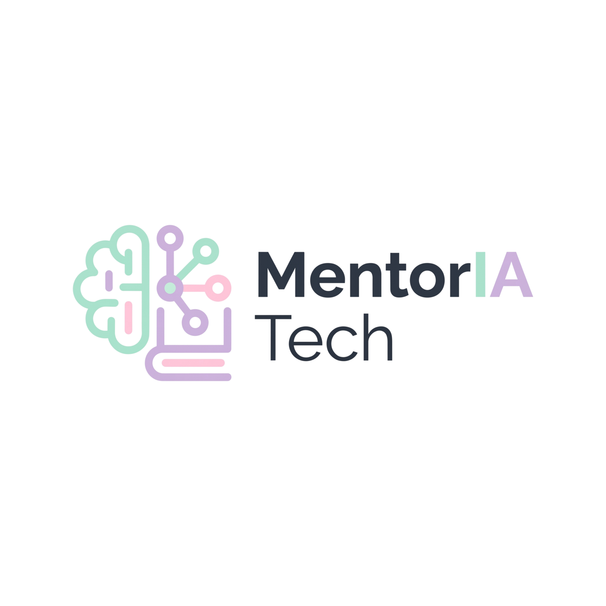
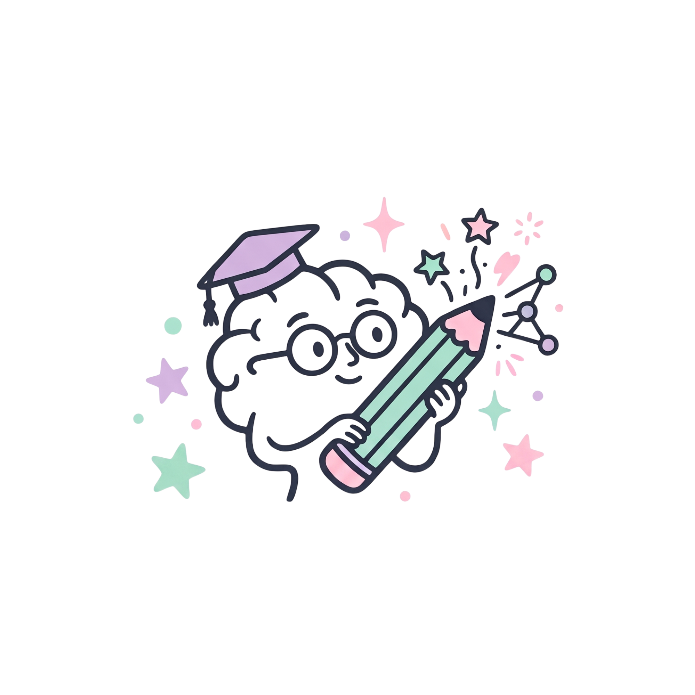
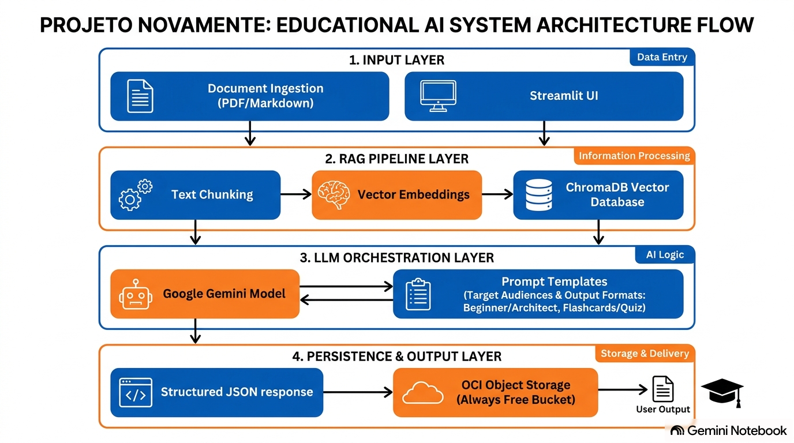
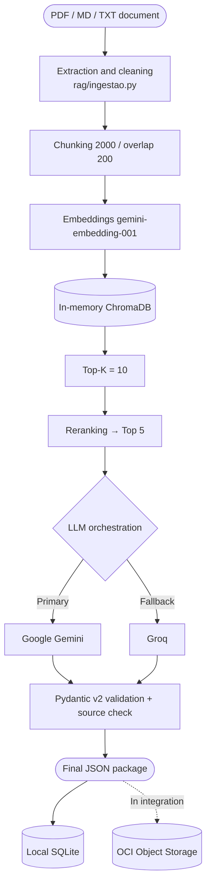

<p align="center">
  
</p>

<p align="center">
  🌎 <a href="./README.md">Português (PT-BR)</a> · <a href="./README.es.md">Español</a> · <strong>English</strong>
</p>

# MentorIA Tech · Hackathon ONE G10 · Team 26

> **An intelligent system that adapts technical documentation into educational content, grounded in real sources through RAG.**
> *Learning with clarity, lightness and autonomy.*

<p align="center">
  
  
  
  
  
  
</p>

---

## 🎯 About the project

**MentorIA Tech** *(initial codename: NovaMente)* is **Team 26**'s solution for **Hackathon ONE G10**, promoted by **Oracle Next Education (ONE)** and **Alura** in partnership with **NoCountry**.

The platform takes technical documentation (a manual, a cloud guide, an article) and turns it into structured study material, personalized by **profile**, **pedagogical format** and **depth level**. It uses **RAG (Retrieval-Augmented Generation)**, LLMs with fallback and contract validation with **Pydantic v2**. The final output is persisted in **OCI Object Storage (Always Free)**.

<p align="center">
  
</p>

### Problem
Technical documentation is dense and full of jargon. Adapting it by hand for different audiences takes weeks, and using an LLM without context control causes hallucinations and loses source traceability.

> **Guiding question:** how can complex technical documentation become accessible, personalized and structured educational content in minutes, without losing fidelity to the original sources?

### Priority audience
1. **Technology students and career-transition professionals** (primary focus).
2. **Junior/Mid developers and Tech Leads**, who need technical summaries with traceable pages and passages.
3. **Executives and EdTech/training platforms**, who need quick views (`TL;DR`, `Summary`).

---

## 🧩 MVP proposal

The MVP processes **one document per run**, in **PT-BR** (the MVP's mandatory language). This English version is a complementary one, for presentations.

| Parameter | Options |
| :--- | :--- |
| **Document** | `.pdf` (with text), `.md`, `.txt` |
| **Profile** | `Iniciante` (Beginner) · `Jr/Pleno` (Junior/Mid) · `Tech Lead` · `Executivo` (Executive) |
| **Format** | `Tutorial` · `Flashcards` · `Quiz` · `TL;DR` · `Roteiro` (Script) · `Resumo` (Summary) |
| **Level** | `basic` · `intermediate` · `advanced` |

> **Decision from the 09/11/2026 meeting:** the `nicho` (niche) field is being deprecated, with a 100% focus on technology education. The `Arquiteto` and `Gestor` profiles are being renamed `Tech Lead` and `Executivo`; the code still uses the old names (see [Status](#-actual-feature-status)).

Every generated item cites **real pages and chunks** from the document, and the system verifies those references deterministically before accepting a response.

---

## 📐 Architecture

<p align="center">
  
</p>



**RAG parameters** (chosen via a 200-combination benchmark: 40 configurations × 5 documents): `chunk_size=2000`, `overlap=200`, `K=10`, `top_n=5`.

---

## 🛠️ Technologies

| Layer | Technologies |
| :--- | :--- |
| **Language and contracts** | Python 3.11+ · Pydantic v2 |
| **Extraction** | `pdfplumber` (multi-format, with tables) · `pypdf` |
| **RAG** | LangChain · ChromaDB · `gemini-embedding-001` |
| **LLMs** | Google Gemini (primary) · Groq `openai/gpt-oss-120b` (fallback) |
| **Persistence** | Local SQLite (SHA-256 hashes, no name/email/IP) · OCI Object Storage |
| **Interface** | Streamlit, with Brandbook UX/UI v1.1 (WCAG AA) |
| **Cloud** | Oracle Cloud Infrastructure (OCI SDK), Always Free tier |

---

## ✅ Actual feature status

| Status | Item |
| :--- | :--- |
| ✅ **IMPLEMENTED** | RAG + LLM pipeline with Gemini → Groq fallback |
| ✅ **IMPLEMENTED** | Pydantic v2 contracts (6 formats) and source verification |
| ✅ **IMPLEMENTED** | SQLite persistence and RAG benchmark (200 experiments) |
| ✅ **IMPLEMENTED** | Multi-format `.pdf/.md/.txt` extractor (PR #40, already on `main`) |
| ✅ **IMPLEMENTED** | 4-screen Streamlit interface with the MentorIA Tech identity (PR #42) |
| 🔄 **IN REVIEW** | Rename profiles to `Tech Lead` / `Executivo`; remove `nicho` |
| 🔄 **IN REVIEW** | API key pool (`GEMINI_API_KEYS`, `GROQ_API_KEYS`) |
| 📝 **PROPOSAL** | OCI Vault, Autonomous Database and BI data model |
| ⏳ **PENDING** | Connecting the frontend (`app/main.py`, currently a simulated engine) to the `rag/` pipeline |
| ⏳ **PENDING** | Real write of the structured JSON to the OCI bucket (`mentoria-tech-artifacts`) |
| 🚀 **POST-MVP** | Power BI, Telegram, QR Code, conversational AI chat, OCR, English/Spanish in the UI |

Details in [`docs/decisoes-e-status.md`](./docs/decisoes-e-status.md) *(in Portuguese)*.

---

## 🎬 Demo scenarios

1. **Tutorial** · *Beginner* · `rag/Machine_Learning.pdf`: step-by-step on datasets, learning types and cross-validation, with page citations.
2. **Flashcards** · *Beginner* · *VCN networking on OCI*: cards about VCNs, subnets, gateways and security lists.
3. **Quiz** · *Junior/Mid* · `rag/Machine_Learning.pdf`: multiple-choice questions with immediate feedback and explanation.

---

## 🚀 Running locally

> Windows (PowerShell). On Linux/macOS, activate with `source .venv/bin/activate`.

```powershell
git clone https://github.com/No-Country-simulation/G10-BRASIL-equipo-26.git
cd G10-BRASIL-equipo-26

py -m venv .venv
.\.venv\Scripts\Activate.ps1
python -m pip install --upgrade pip
python -m pip install -r requirements.txt
```

**Environment variables:** copy the template and fill it in locally only. `rag/.env` is in `.gitignore` and **must never be pushed to GitHub**.

```powershell
Copy-Item .\rag\.env.example .\rag\.env
```
```dotenv
GEMINI_API_KEY=
GROQ_API_KEY=
```

**Interface (works without keys, using preloaded scenarios):**
```powershell
streamlit run app/main.py
```
Open `http://localhost:8501`.

**Real pipeline (requires keys):**
```powershell
python .\rag\teste_integracao.py .\rag\Machine_Learning.pdf
```

---

## ☁️ Oracle Cloud (OCI)

The MVP uses the **Always Free** tier only, with the `mentoria-tech` compartment, least-privilege groups and policies, and **private** buckets. The structured JSON output is the mandatory persistence requirement. No credential is ever versioned: use environment variables, the `~/.oci/config` file (outside the repository) or OCI Vault.

Guides *(in Portuguese)*: [`docs/oci-tutorial.md`](./docs/oci-tutorial.md) · [`docs/integracao-oci.md`](./docs/integracao-oci.md)

---

## 📚 Documentation (`docs/`)

| Document | Content |
| :--- | :--- |
| [`pitch.md`](./docs/pitch.md) | Pitch and AI Canvas |
| [`arquitetura-mvp.md`](./docs/arquitetura-mvp.md) | Modules, contracts and integration |
| [`integracao-oci.md`](./docs/integracao-oci.md) | IAM, Object Storage, Vault and Autonomous Database |
| [`oci-tutorial.md`](./docs/oci-tutorial.md) | Step-by-step OCI tutorial |
| [`qa-plano.md`](./docs/qa-plano.md) | QA plan and STAR method |
| [`metricas-kpis.md`](./docs/metricas-kpis.md) | Metrics, KPIs and BI model |
| [`decisoes-e-status.md`](./docs/decisoes-e-status.md) | Decisions and actual status |
| [`engenharia-prompts-e-mercado.md`](./docs/engenharia-prompts-e-mercado.md) | Prompts per profile/format and market analysis |
| [`nocountry-entregavel.md`](./docs/nocountry-entregavel.md) | MVP document for NoCountry (≤ 10,000 characters) |
| [`guia-github-projects.md`](./docs/guia-github-projects.md) | GitHub Projects sync guide |
| [`atas/`](./docs/atas/) | Sanitized meeting minutes (LGPD) |

---

## 👥 Team 26

Official roles as registered on NoCountry, alongside actual contributions to the project.

| Member | NoCountry role | Role in the project |
| :--- | :--- | :--- |
| **Lídia Moura** | BI Analyst | Tech lead, OCI setup, QA and documentation |
| **Andrea De Nardi Gonzalez** | Data Analyst | Compliance and Scrum Master |
| **Rodrigo Silva do Carmo** | Data Scientist | RAG/LLM architecture, Pydantic contracts, benchmark |
| **Wagner Julio de Campos** | Full Stack Developer | Streamlit front-end and integration |
| **Josiane da Silva** | Full Stack Developer | Full stack |
| **Marcos Vinicius Ferreira de Oliveira** | Backend Developer | Back-end, ingestion and document extraction |
| **Lysara Jacó Pinheiro** | Data Analyst | Brand, Brandbook, UX/UI and marketing |
| **Vagner Marques de Souza Lopes** | Data Analyst | Data, schemas and integration |
| **Leonardo Santos** | Data Analyst | Data and document extraction |
| **João Okuyama** | Data Analyst | Data and GitHub administration |

---

## 🤖 Transparency on AI use

The documentation, test structure and organization of this repository were supported by the Antigravity tool (AI assistant) as a productivity instrument. All generated content was produced under **the supervision, governance and review of Lídia Moura** (Tech Lead). Product decisions, experiments and validations were carried out and approved by Team 26.

---

## 📄 License

[MIT](./LICENSE) · Last updated: 12/11/2026 · Owner: Lídia Moura (Tech Lead).

