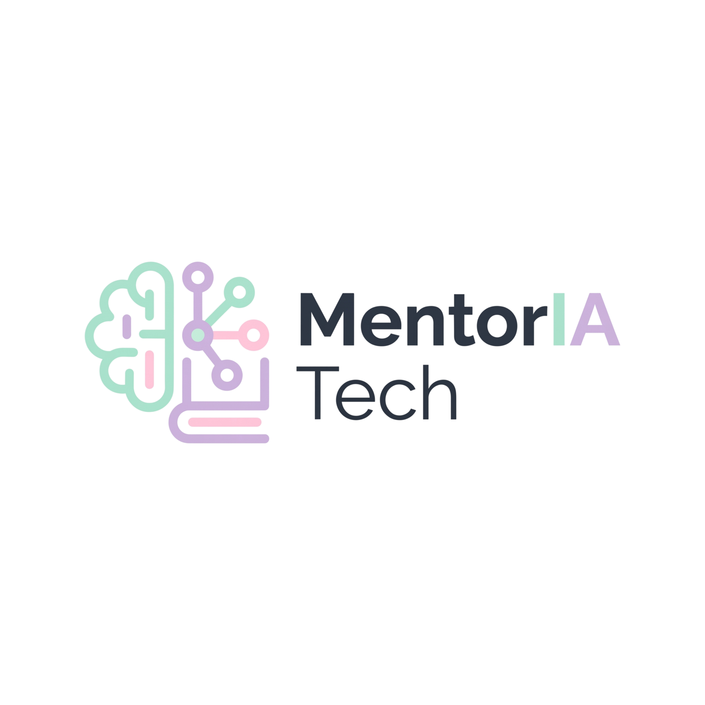
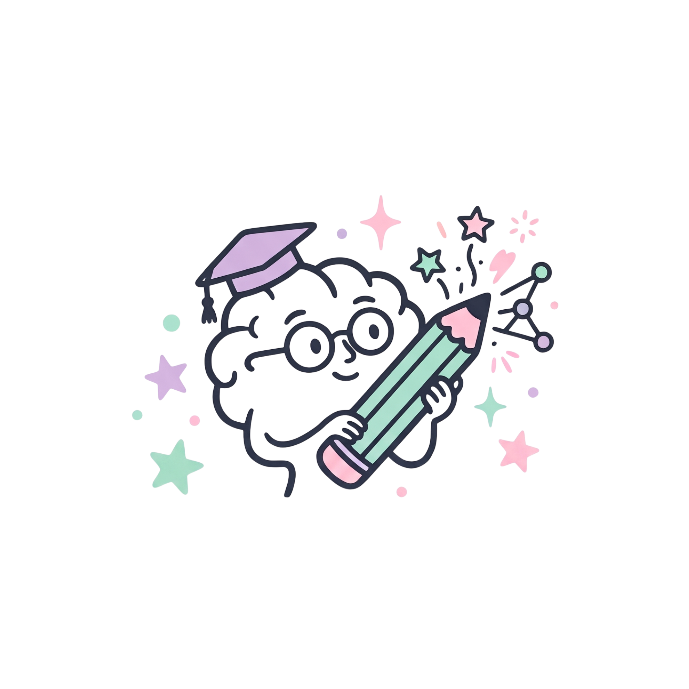
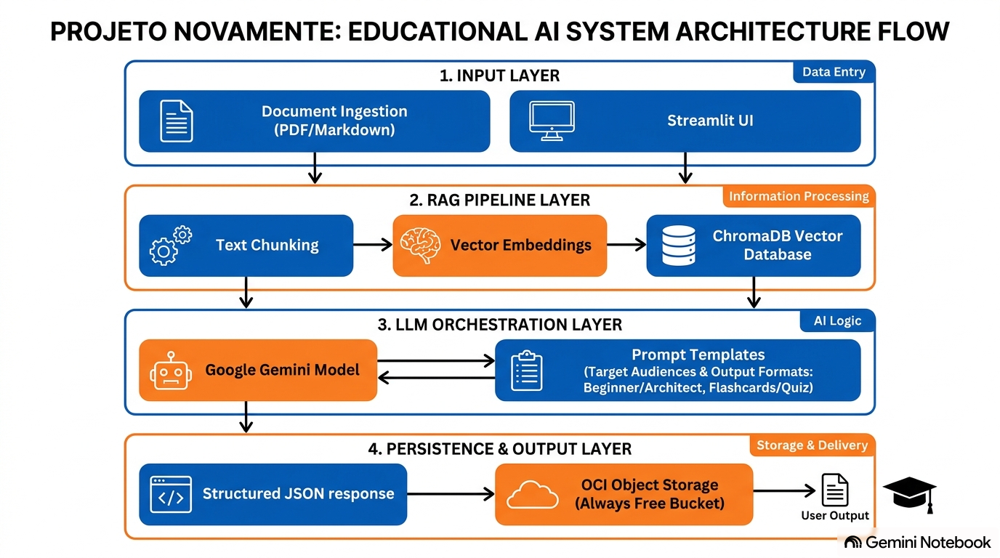
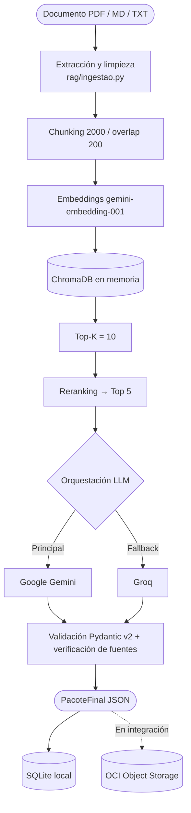

<p align="center">
  
</p>

<p align="center">
  🌎 <a href="./README.md">Português (PT-BR)</a> · <strong>Español</strong> · <a href="./README.en.md">English</a>
</p>

# MentorIA Tech · Hackathon ONE G10 · Equipo 26

> **Sistema inteligente de adaptación y generación de contenido educativo técnico, anclado en fuentes reales mediante RAG.**
> *Aprender con claridad, ligereza y autonomía.*

<p align="center">
  
  
  
  
  
  
</p>

---

## 🎯 Sobre el proyecto

**MentorIA Tech** *(nombre en clave inicial: NovaMente)* es la solución del **Equipo 26** para el **Hackathon ONE G10**, impulsado por **Oracle Next Education (ONE)** y **Alura**, junto con **NoCountry**.

La plataforma recibe documentación técnica (manual, guía de nube, artículo) y la convierte en material de estudio estructurado, personalizado por **perfil**, **formato pedagógico** y **nivel de profundidad**. Usa **RAG (Retrieval-Augmented Generation)**, LLMs con *fallback* y validación de contratos con **Pydantic v2**. La salida final se persiste en **OCI Object Storage (Always Free)**.

<p align="center">
  
</p>

### Problema
La documentación técnica es densa y está llena de jerga. Adaptarla a mano para públicos distintos lleva semanas, y usar un LLM sin control de contexto produce alucinaciones y pierde la trazabilidad de las fuentes.

> **Pregunta guía:** ¿cómo convertir documentación técnica compleja en contenido educativo accesible, personalizado y estructurado en minutos, sin perder la fidelidad a las fuentes originales?

### Público prioritario
1. **Estudiantes de tecnología y profesionales en transición de carrera** (foco principal).
2. **Desarrolladores Jr/Pleno y Tech Leads**, que necesitan síntesis técnicas con páginas y fragmentos trazables.
3. **Ejecutivos y plataformas EdTech/capacitación**, que necesitan vistas rápidas (`TL;DR`, `Resumen`).

---

## 🧩 Propuesta del MVP

El MVP procesa **un documento por ejecución**, en **PT-BR** (idioma obligatorio del MVP). Esta versión en español es complementaria, para presentaciones.

| Parámetro | Opciones |
| :--- | :--- |
| **Documento** | `.pdf` (con texto), `.md`, `.txt` |
| **Perfil** | `Iniciante` · `Jr/Pleno` · `Tech Lead` · `Executivo` |
| **Formato** | `Tutorial` · `Flashcards` · `Quiz` · `TL;DR` · `Roteiro` · `Resumo` |
| **Nivel** | `básico` · `intermedio` · `avanzado` |

> **Decisión de la reunión del 09/11/2026:** el campo `nicho` se está descontinuando, con foco 100 % en educación en tecnología. Los perfiles `Arquiteto` y `Gestor` pasan a llamarse `Tech Lead` y `Executivo`; el código aún conserva los nombres antiguos (ver [Estado](#-estado-real-de-las-funcionalidades)).

Cada elemento generado cita **páginas y chunks reales** del documento, y el sistema verifica esas referencias de forma determinística antes de aceptar la respuesta.

---

## 📐 Arquitectura

<p align="center">
  
</p>



**Parámetros del RAG** (definidos con un benchmark de 200 combinaciones: 40 configuraciones × 5 documentos): `chunk_size=2000`, `overlap=200`, `K=10`, `top_n=5`.

---

## 🛠️ Tecnologías

| Capa | Tecnologías |
| :--- | :--- |
| **Lenguaje y contratos** | Python 3.11+ · Pydantic v2 |
| **Extracción** | `pdfplumber` (multiformato, con tablas) · `pypdf` |
| **RAG** | LangChain · ChromaDB · `gemini-embedding-001` |
| **LLMs** | Google Gemini (principal) · Groq `openai/gpt-oss-120b` (fallback) |
| **Persistencia** | SQLite local (hash SHA-256, sin nombre/correo/IP) · OCI Object Storage |
| **Interfaz** | Streamlit, con Brandbook UX/UI v1.1 (WCAG AA) |
| **Nube** | Oracle Cloud Infrastructure (OCI SDK), capa Always Free |

---

## ✅ Estado real de las funcionalidades

| Estado | Elemento |
| :--- | :--- |
| ✅ **IMPLEMENTADO** | Pipeline RAG + LLM con fallback Gemini → Groq |
| ✅ **IMPLEMENTADO** | Contratos Pydantic v2 (6 formatos) y verificación de fuentes |
| ✅ **IMPLEMENTADO** | Persistencia SQLite y benchmark RAG (200 experimentos) |
| ✅ **IMPLEMENTADO** | Extractor multiformato `.pdf/.md/.txt` (PR #40, ya en `main`) |
| ✅ **IMPLEMENTADO** | Interfaz Streamlit en 4 pantallas con identidad MentorIA Tech (PR #42) |
| 🔄 **EN REVISIÓN** | Renombrar perfiles a `Tech Lead` / `Executivo`; eliminar `nicho` |
| 🔄 **EN REVISIÓN** | Pool de claves de API (`GEMINI_API_KEYS`, `GROQ_API_KEYS`) |
| 📝 **PROPUESTA** | OCI Vault, Autonomous Database y esquema de BI |
| ⏳ **PENDIENTE** | Conexión del frontend (`app/main.py`, hoy con motor simulado) al pipeline `rag/` |
| ⏳ **PENDIENTE** | Escritura real del JSON estructurado en el bucket OCI (`mentoria-tech-artifacts`) |
| 🚀 **POST-MVP** | Power BI, Telegram, QR Code, chat de IA conversacional, OCR, inglés/español en la interfaz |

Detalles en [`docs/decisoes-e-status.md`](./docs/decisoes-e-status.md) *(en portugués)*.

---

## 🎬 Escenarios de demostración

1. **Tutorial** · *Iniciante* · `rag/Machine_Learning.pdf`: paso a paso sobre datasets, tipos de aprendizaje y validación cruzada, con cita de páginas.
2. **Flashcards** · *Iniciante* · *Redes VCN en OCI*: tarjetas sobre VCN, subredes, gateways y security lists.
3. **Quiz** · *Jr/Pleno* · `rag/Machine_Learning.pdf`: preguntas de opción múltiple con retroalimentación y explicación inmediatas.

---

## 🚀 Cómo ejecutar localmente

> Windows (PowerShell). En Linux/macOS, activa con `source .venv/bin/activate`.

```powershell
git clone https://github.com/No-Country-simulation/G10-BRASIL-equipo-26.git
cd G10-BRASIL-equipo-26

py -m venv .venv
.\.venv\Scripts\Activate.ps1
python -m pip install --upgrade pip
python -m pip install -r requirements.txt
```

**Variables de entorno:** copia la plantilla y complétala solo en local. `rag/.env` está en `.gitignore` y **nunca debe subirse a GitHub**.

```powershell
Copy-Item .\rag\.env.example .\rag\.env
```
```dotenv
GEMINI_API_KEY=
GROQ_API_KEY=
```

**Interfaz (funciona sin claves, con escenarios precargados):**
```powershell
streamlit run app/main.py
```
Abre `http://localhost:8501`.

**Pipeline real (requiere claves):**
```powershell
python .\rag\teste_integracao.py .\rag\Machine_Learning.pdf
```

---

## ☁️ Oracle Cloud (OCI)

El MVP usa únicamente la capa **Always Free**, con el compartimento `mentoria-tech`, grupos y políticas de mínimo privilegio y buckets **privados**. La salida JSON estructurada es el requisito obligatorio de persistencia. No se versiona ninguna credencial: usa variables de entorno, el archivo `~/.oci/config` (fuera del repositorio) u OCI Vault.

Guías *(en portugués)*: [`docs/oci-tutorial.md`](./docs/oci-tutorial.md) · [`docs/integracao-oci.md`](./docs/integracao-oci.md)

---

## 📚 Documentación (`docs/`)

| Documento | Contenido |
| :--- | :--- |
| [`pitch.md`](./docs/pitch.md) | Pitch y AI Canvas |
| [`arquitetura-mvp.md`](./docs/arquitetura-mvp.md) | Módulos, contratos e integración |
| [`integracao-oci.md`](./docs/integracao-oci.md) | IAM, Object Storage, Vault y Autonomous Database |
| [`oci-tutorial.md`](./docs/oci-tutorial.md) | Tutorial paso a paso de OCI |
| [`qa-plano.md`](./docs/qa-plano.md) | Plan de QA y método STAR |
| [`metricas-kpis.md`](./docs/metricas-kpis.md) | Métricas, KPIs y modelo para BI |
| [`decisoes-e-status.md`](./docs/decisoes-e-status.md) | Decisiones y estado real |
| [`engenharia-prompts-e-mercado.md`](./docs/engenharia-prompts-e-mercado.md) | Prompts por perfil/formato y análisis de mercado |
| [`nocountry-entregavel.md`](./docs/nocountry-entregavel.md) | Documento del MVP para NoCountry (≤ 10.000 caracteres) |
| [`guia-github-projects.md`](./docs/guia-github-projects.md) | Sincronización con GitHub Projects |
| [`atas/`](./docs/atas/) | Actas anonimizadas (LGPD) |

---

## 👥 Equipo 26

Funciones oficiales según el registro en NoCountry, junto con la actuación real en el proyecto.

| Integrante | Función en NoCountry | Actuación en el proyecto |
| :--- | :--- | :--- |
| **Lídia Moura** | BI Analyst | Liderazgo técnico, configuración OCI, QA y documentación |
| **Andrea De Nardi Gonzalez** | Data Analyst | Compliance y Scrum Master |
| **Rodrigo Silva do Carmo** | Data Scientist | Arquitectura RAG/LLM, contratos Pydantic, benchmark |
| **Wagner Julio de Campos** | Full Stack Developer | Front-end Streamlit e integración |
| **Josiane da Silva** | Full Stack Developer | Full stack |
| **Marcos Vinicius Ferreira de Oliveira** | Backend Developer | Back-end, ingesta y extracción de documentos |
| **Lysara Jacó Pinheiro** | Data Analyst | Marca, Brandbook, UX/UI y marketing |
| **Vagner Marques de Souza Lopes** | Data Analyst | Datos, esquemas e integración |
| **Leonardo Santos** | Data Analyst | Datos y extracción de documentos |
| **João Okuyama** | Data Analyst | Datos y administración de GitHub |

---

## 🤖 Transparencia sobre el uso de IA

La documentación, la estructura de pruebas y la organización de este repositorio contaron con apoyo de la herramienta Antigravity (IA asistente) como instrumento de productividad. Todo el contenido generado fue producido bajo **supervisión, gobernanza y revisión de Lídia Moura** (Líder Técnica). Las decisiones de producto, experimentos y validaciones fueron realizadas y aprobadas por el Equipo 26.

---

## 📄 Licencia

[MIT](./LICENSE) · Última actualización: 12/11/2026 · Responsable: Lídia Moura (Líder Técnica).

