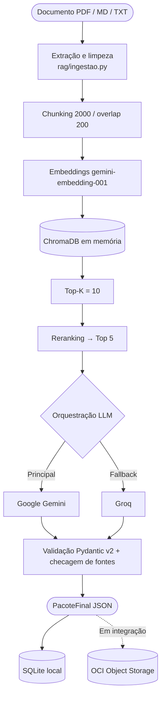

<p align="center">
  
</p>

<p align="center">
  🌎 <strong>Português (PT-BR)</strong> · <a href="./README.es.md">Español</a> · <a href="./README.en.md">English</a>
</p>

# MentorIA Tech · Hackathon ONE G10 · Equipe 26

> **Sistema inteligente de adaptação e geração de conteúdo educacional técnico, ancorado em fontes reais via RAG.**
> *Aprender com clareza, leveza e autonomia.*

<p align="center">
  
  
  
  
  
  
</p>

---

## Sobre o projeto

O **MentorIA Tech** *(codinome inicial: NovaMente)* é a solução da **Equipe 26** para o **Hackathon ONE G10**, promovido por **Oracle Next Education (ONE)** e **Alura**, em parceria com a **NoCountry**.

A plataforma recebe uma documentação técnica (manual, guia de nuvem, artigo) e a transforma em material de estudo estruturado, personalizado por **perfil**, **formato pedagógico** e **nível de profundidade**. Usa **RAG (Retrieval-Augmented Generation)**, LLMs com fallback e validação de contratos com **Pydantic v2**, com a saída final persistida no **OCI Object Storage (Always Free)**.

<p align="center">
  
</p>

### Problema
Documentações técnicas são densas e cheias de jargões. Adaptá-las à mão para públicos diferentes leva semanas, e usar uma LLM sem controle de contexto gera alucinações e perda de rastreabilidade.

> **Pergunta norteadora:** como transformar documentação técnica complexa em conteúdo educacional acessível, personalizado e estruturado em minutos, sem perder a fidelidade às fontes originais?

### Público prioritário
1. **Estudantes de tecnologia e profissionais em transição de carreira** (foco primário).
2. **Desenvolvedores Jr/Pleno e Tech Leads**, que precisam de sínteses técnicas com páginas e trechos rastreáveis.
3. **Executivos e plataformas EdTech/treinamento**, que precisam de visões rápidas (`TL;DR`, `Resumo`).

---

## Proposta do MVP

O MVP processa **um documento por execução**, em **PT-BR** (idioma obrigatório).

| Parâmetro | Opções |
| :--- | :--- |
| **Documento** | `.pdf` (com texto), `.md`, `.txt` |
| **Perfil** | `Iniciante` · `Jr/Pleno` · `Tech Lead` · `Executivo` |
| **Formato** | `Tutorial` · `Flashcards` · `Quiz` · `TL;DR` · `Roteiro` · `Resumo` |
| **Nível** | `básico` · `intermediário` · `avançado` |

> **Decisão da reunião de 09/11/2026:** o campo `nicho` está sendo descontinuado, com foco 100% em educação em tecnologia. Os perfis `Arquiteto` e `Gestor` passam a se chamar `Tech Lead` e `Executivo`; no código ainda constam os nomes antigos (ver [Status](#-status-real-das-funcionalidades)).

Todo item gerado cita **páginas e chunks reais** do documento, e o sistema verifica essas referências de forma determinística antes de aceitar a resposta.

---

## Arquitetura

<p align="center">
  
</p>



**Parâmetros do RAG** (definidos por benchmark de 200 combinações: 40 configurações × 5 documentos): `chunk_size=2000`, `overlap=200`, `K=10`, `top_n=5`.

---

## 🛠️ Tecnologias

| Camada | Tecnologias |
| :--- | :--- |
| **Linguagem e contratos** | Python 3.11+ · Pydantic v2 |
| **Extração** | `pdfplumber` (multi-formato, com tabelas) · `pypdf` |
| **RAG** | LangChain · ChromaDB · `gemini-embedding-001` |
| **LLMs** | Google Gemini (principal) · Groq `openai/gpt-oss-120b` (fallback) |
| **Persistência** | SQLite local (hash SHA-256, sem nome/e-mail/IP) · OCI Object Storage |
| **Interface** | Streamlit, com Brandbook UX/UI v1.1 (WCAG AA) |
| **Nuvem** | Oracle Cloud Infrastructure (OCI SDK), camada Always Free |

---

## Status real das funcionalidades

| Status | Item |
| :--- | :--- |
|  **IMPLEMENTADO** | Pipeline RAG + LLM com fallback Gemini → Groq |
|  **IMPLEMENTADO** | Contratos Pydantic v2 (6 formatos) e verificação de fontes |
|  **IMPLEMENTADO** | Persistência SQLite, benchmark RAG (200 experimentos) |
|  **IMPLEMENTADO** | Extrator multi-formato `.pdf/.md/.txt` (PR #40, já na `main`) |
|  **IMPLEMENTADO** | Interface Streamlit em 4 telas com identidade MentorIA Tech (PR #42) |
|  **EM REVISÃO** | Renomear perfis para `Tech Lead` / `Executivo`; remover `nicho` |
|  **EM REVISÃO** | Pool de chaves de API (`GEMINI_API_KEYS`, `GROQ_API_KEYS`) |
|  **PROPOSTA** | OCI Vault, Autonomous Database e esquema de BI |
|  **PENDENTE** | Conexão do frontend (`app/main.py`, hoje com motor simulado) ao pipeline `rag/` |
|  **PENDENTE** | Gravação real do JSON estruturado no bucket OCI (`mentoria-tech-artifacts`) |
|  **PÓS-MVP** | Power BI, Telegram, QR Code, chat de IA conversacional, OCR, inglês/espanhol na interface |

Detalhes e justificativas em [`docs/decisoes-e-status.md`](./docs/decisoes-e-status.md).

---

## Cenários de demonstração

1. **Tutorial** · *Iniciante* · `rag/Machine_Learning.pdf`: passo a passo sobre datasets, tipos de aprendizado e validação cruzada, com citação de páginas.
2. **Flashcards** · *Iniciante* · *Redes VCN na OCI*: cartões sobre VCN, sub-redes, gateways e security lists.
3. **Quiz** · *Jr/Pleno* · `rag/Machine_Learning.pdf`: questões de múltipla escolha com feedback e explicação imediatos.

---

## Como executar localmente

> Windows (PowerShell). No Linux/macOS, troque a ativação por `source .venv/bin/activate`.

```powershell
git clone https://github.com/No-Country-simulation/G10-BRASIL-equipo-26.git
cd G10-BRASIL-equipo-26

py -m venv .venv
.\.venv\Scripts\Activate.ps1
python -m pip install --upgrade pip
python -m pip install -r requirements.txt
```

**Variáveis de ambiente:** copie o modelo e preencha localmente. O `rag/.env` está no `.gitignore` e **nunca deve ir para o GitHub**.

```powershell
Copy-Item .\rag\.env.example .\rag\.env
```
```dotenv
GEMINI_API_KEY=
GROQ_API_KEY=
```

**Interface (funciona sem chaves, com cenários pré-carregados):**
```powershell
streamlit run app/main.py
```
Acesse `http://localhost:8501`.

**Pipeline real (requer chaves):**
```powershell
python .\rag\teste_integracao.py .\rag\Machine_Learning.pdf
```

---

## Oracle Cloud (OCI)

O MVP usa exclusivamente a camada **Always Free**, com compartimento `mentoria-tech`, grupos e policies de menor privilégio e buckets **privados**. A saída JSON estruturada é o requisito obrigatório de persistência. Nenhuma credencial é versionada: use variáveis de ambiente, o arquivo `~/.oci/config` (fora do repositório) ou OCI Vault.

Guias: [`docs/oci-tutorial.md`](./docs/oci-tutorial.md) · [`docs/integracao-oci.md`](./docs/integracao-oci.md)

---

## Documentação (`docs/`)

| Documento | Conteúdo |
| :--- | :--- |
| [`pitch.md`](./docs/pitch.md) | Pitch e AI Canvas |
| [`arquitetura-mvp.md`](./docs/arquitetura-mvp.md) | Módulos, contratos e integração |
| [`integracao-oci.md`](./docs/integracao-oci.md) | IAM, Object Storage, Vault e Autonomous Database |
| [`oci-tutorial.md`](./docs/oci-tutorial.md) | Tutorial passo a passo da OCI |
| [`qa-plano.md`](./docs/qa-plano.md) | Plano de QA e método STAR |
| [`metricas-kpis.md`](./docs/metricas-kpis.md) | Métricas, KPIs e modelo para BI |
| [`decisoes-e-status.md`](./docs/decisoes-e-status.md) | Decisões e status real |
| [`engenharia-prompts-e-mercado.md`](./docs/engenharia-prompts-e-mercado.md) | Prompts por perfil/formato e análise de mercado |
| [`nocountry-entregavel.md`](./docs/nocountry-entregavel.md) | Documento do MVP para a NoCountry (≤ 10.000 caracteres) |
| [`guia-github-projects.md`](./docs/guia-github-projects.md) | Sincronização com o GitHub Projects |
| [`atas/`](./docs/atas/) | Atas higienizadas (LGPD) |

---

## Equipe 26

Funções oficiais conforme o cadastro na NoCountry, com a atuação real no projeto.

| Integrante | Função na NoCountry | Atuação no projeto |
| :--- | :--- | :--- |
| **Lídia Moura** | BI Analyst | Liderança técnica, configuração OCI, QA e documentação |
| **Andrea De Nardi Gonzalez** | Data Analyst | Compliance e Scrum Master |
| **Rodrigo Silva do Carmo** | Data Scientist | Arquitetura RAG/LLM, contratos Pydantic, benchmark |
| **Wagner Julio de Campos** | Full Stack Developer | Front-end Streamlit e integração |
| **Josiane da Silva** | Full Stack Developer | Full stack |
| **Marcos Vinicius Ferreira de Oliveira** | Backend Developer | Back-end, ingestão e extração de documentos |
| **Lysara Jacó Pinheiro** | Data Analyst | Marca, Brandbook, UX/UI e marketing |
| **Vagner Marques de Souza Lopes** | Data Analyst | Dados, schemas e integração |
| **Leonardo Santos** | Data Analyst | Dados e extração de documentos |
| **João Okuyama** | Data Analyst | Dados e administração do GitHub |

---

## Transparência sobre o uso de IA

A documentação, a estrutura de testes e a organização deste repositório contaram com apoio da ferramenta Antigravity (IA assistente) como instrumento de produtividade. Toda geração de conteúdo foi realizada sob **supervisão, governança e revisão da Lídia Moura** (Líder Técnica). As decisões de produto, experimentos e validações foram conduzidos e aprovados pela Equipe 26.

---

## Licença

[MIT](./LICENSE) · Última atualização: 12/11/2026 · Responsável: Lídia Moura (Líder Técnica).
