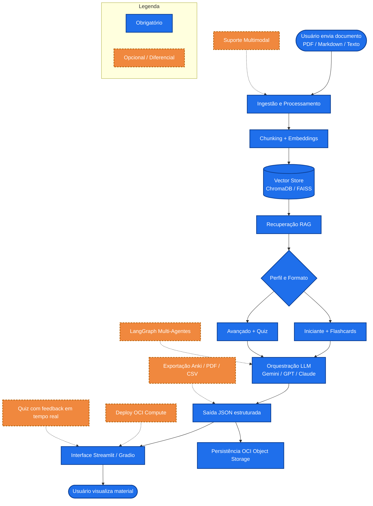

# G10-Brasil-Equipe-26-NovaMente
NovaMente — adaptação de conteúdo educacional com IA generativa, RAG e OCI Object Storage. Hackathon ONE G10.

# Arquitetura do NovaMente

## Visão geral

O NovaMente é uma ferramenta de estudo baseada em nuvem que recebe documentos
(PDF, Markdown ou texto), processa via RAG e gera materiais didáticos adaptados
ao perfil do usuário e ao formato escolhido.

O fluxograma abaixo mostra o pipeline principal (em azul, requisitos
obrigatórios) e os diferenciais opcionais (em laranja tracejado).

# Descrição das etapas obrigatórias

1. **Ingestão e Processamento:**
O usuário envia um arquivo pela interface (Streamlit ou Gradio) ou pelo bot do
Telegram. O sistema identifica o tipo (PDF, Markdown ou texto) e extrai o
conteúdo textual com PyPDF ou parser equivalente.

2. **Chunking + Embeddings:**
O texto extraído é dividido em blocos de tamanho fixo (ex.: 512 tokens com
overlap de 50) e cada bloco é convertido em vetor por um modelo de embedding.
A escolha do tamanho do chunk afeta diretamente a qualidade da recuperação.

3. **Vector Store:**
Os vetores são armazenados em ChromaDB ou FAISS, permitindo busca por
similaridade semântica. Cada vetor mantém metadados (fonte, página, seção)
para rastreabilidade.

4. **Recuperação RAG:**
Dada uma consulta (ou o pedido de geração de material), o sistema recupera os
top-K fragmentos mais relevantes. Antes de enviar ao LLM, aplica-se
deduplicação por similaridade de embedding para evitar conteúdo repetido.

5. **Orquestração LLM:**
Os fragmentos deduplicados são inseridos em um prompt que instrui o modelo
a gerar o material no formato escolhido (flashcards,
quiz ou tutorial) e no nível do perfil (iniciante ou avançado).

6. **Saída JSON estruturada:**
A resposta do LLM é validada com Pydantic (Structured Outputs) para garantir
o formato JSON correto antes de ser exibida ou persistida.

7. **Interface e Persistência:**
O resultado é exibido na interface (Streamlit/Gradio) e os arquivos originais
e artefatos gerados são salvos no bucket OCI Object Storage (camada Always
Free) via oci-sdk.

# Descrição das etapas opcionais

1. **LangGraph Multi-Agentes:** roteador com Agente Pesquisador (RAG), Agente
Redator Pedagógico e Agente Crítico/Revisor. Acopla-se à etapa de
orquestração LLM.

2. **Exportação multiformato:** download em Markdown, PDF didático ou CSV
compatível com Anki. Acopla-se à saída JSON.

3. **Deploy OCI Compute:** hospedagem da aplicação em VM Linux na camada Always
Free.

4. **Quiz com feedback em tempo real:** o aluno responde as perguntas geradas e
recebe explicação imediata.

5. **Suporte multimodal:** interpretação de diagramas e tabelas contidos no
documento original, exigindo modelo de visão (ex.: Gemini Vision) na etapa
de ingestão.

4. **Quiz com feedback em tempo real:** o aluno responde as perguntas geradas e
recebe explicação imediata.

5. **Suporte multimodal:** interpretação de diagramas e tabelas contidos no
documento original, exigindo modelo de visão (ex.: Gemini Vision) na etapa
de ingestão.
