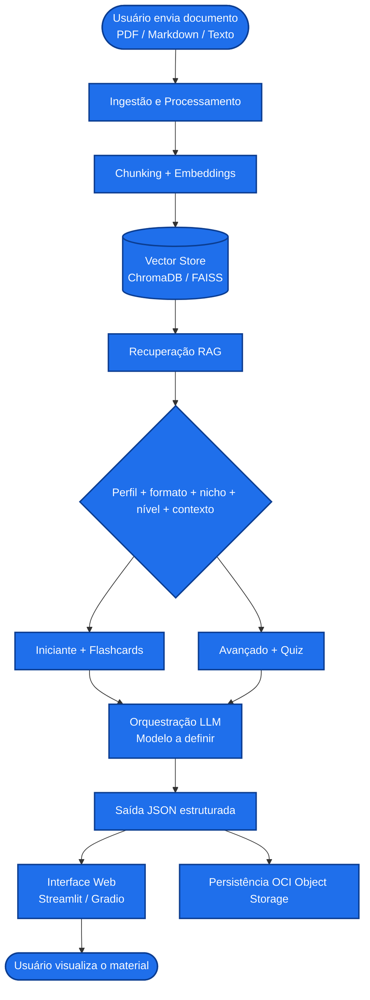

# NovaMente — Equipe 26 | Hackathon ONE G10

  
  
  
  

 

  <strong>Sistema inteligente de adaptação e geração de conteúdo educacional técnico.</strong>

 

  <a href="#sobre-o-projeto">Sobre</a> •
  <a href="#objetivo">Objetivo</a> •
  <a href="#escopo-do-desafio">Escopo</a> •
  <a href="#equipe-26">Equipe</a> •
  <a href="#arquitetura-de-referência">Arquitetura</a> •
  <a href="#status-do-projeto">Status</a>

---

## Sobre o projeto

O **NovaMente** é o projeto da Equipe 26 para o Hackathon ONE G10, promovido pela Oracle Next Education e pela Alura em parceria com a NoCountry.

A proposta é investigar e desenvolver uma solução capaz de transformar documentações técnicas em conteúdos educacionais personalizados, considerando diferentes perfis de destinatários, contextos de aplicação e formatos pedagógicos.

O projeto combina Inteligência Artificial Generativa, Retrieval-Augmented Generation (RAG ), orquestração de prompts ou agentes e recursos da Oracle Cloud Infrastructure (OCI).

> Este README é uma proposta inicial para validação da equipe. O pitch, o escopo final do MVP, a arquitetura e as responsabilidades poderão ser atualizados conforme as decisões coletivas.

## Objetivo

Criar um MVP capaz de receber uma documentação técnica e gerar conteúdos educacionais adaptados ao perfil e às necessidades do destinatário, mantendo fidelidade às fontes originais.

## Problema

Documentações técnicas podem ser extensas, complexas e pouco acessíveis para pessoas com diferentes níveis de conhecimento. A transformação manual desses materiais em tutoriais, resumos, quizzes ou flashcards exige tempo, conhecimento especializado e esforço de revisão.

O NovaMente parte da seguinte questão:

> Como transformar documentação técnica complexa em conteúdos educacionais mais acessíveis e personalizados, utilizando IA Generativa e RAG sem perder a fidelidade às fontes originais?

## Proposta inicial

A solução deverá permitir que o usuário forneça um material técnico e selecione os parâmetros que orientam a geração do conteúdo educacional. O resultado depende não apenas do documento, mas também do perfil do destinatário, do nível de detalhe, do contexto de uso, do nicho de aplicação e do formato pedagógico escolhido.

### Inputs previstos

- **Material técnico:** arquivo PDF, Markdown ou texto bruto;

- **Título do documento:** identificação do material de origem;

- **Perfil do destinatário:** iniciante/transição de carreira, desenvolvedor júnior/pleno, líder técnico/arquiteto ou gestor/executivo não técnico;

- **Formato pedagógico de saída:** tutorial, flashcards, quiz, resumo executivo ou roteiro de aula/vídeo;

- **Nicho ou setor de aplicação:** fintech, saúde, e-commerce ou contexto geral;

- **Nível de detalhe e abordagem:** didático, objetivo ou aprofundado;

- **Contexto do usuário:** finalidade, situação de aprendizagem ou aplicação prática desejada.

### Metadados esperados na saída

- conceitos-chave;

- pré-requisitos;

- tempo estimado de estudo;

- conteúdo adaptado;

- avaliação pedagógica;

- evidências ou referências aos trechos recuperados;

- status e validação da saída estruturada.

### Possíveis formatos de saída

- Tutorial passo a passo;

- Flashcards;

- Quiz com justificativas;

- Resumo executivo;

- Roteiro de aula ou vídeo.

Essas opções representam hipóteses de produto e serão priorizadas pela equipe conforme o escopo do MVP.

## Escopo do desafio

Conforme a proposta do Hackathon ONE G10, o projeto deverá investigar ou implementar:

- ingestão de documentos técnicos;

- extração e preparação do conteúdo;

- segmentação em chunks;

- geração de embeddings;

- armazenamento e busca vetorial;

- recuperação de contexto por RAG;

- utilização de LLM para adaptação do conteúdo;

- orquestração de prompts, cadeias ou agentes;

- avaliação de coerência e fidelidade;

- saída estruturada em JSON;

- interface interativa ou API REST;

- persistência de documentos e resultados no OCI Object Storage Always Free.

O escopo final do MVP será definido e priorizado pela equipe a partir dos requisitos do desafio, do prazo disponível e da capacidade de implementação.

## Pitch statement inicial

> O NovaMente transforma documentações técnicas complexas em conteúdos educacionais personalizados para diferentes perfis de aprendizagem, utilizando RAG e IA Generativa para adaptar o formato e a linguagem com maior fidelidade às fontes originais.

Esta versão será revisada pela equipe durante a definição do problema, do público prioritário, do diferencial e do fluxo do MVP.

## Cenários de demonstração propostos

Os três cenários abaixo são uma proposta inicial para demonstrar a adaptação de um mesmo documento técnico. Eles ainda precisam ser validados e ajustados pela equipe.

### Cenário 1 — Iniciante em transição de carreira

- **Documento:** Introdução à Arquitetura de Redes VCN na OCI;

- **Perfil:** iniciante/transição de carreira;

- **Formato:** flashcards de memorização;

- **Nicho:** geral;

- **Nível:** didático;

- **Objetivo:** apresentar os conceitos fundamentais com linguagem acessível, analogias e pré-requisitos.

### Cenário 2 — Desenvolvedor em contexto de aplicação

- **Documento:** o mesmo material sobre VCN na OCI;

- **Perfil:** desenvolvedor júnior/pleno;

- **Formato:** tutorial passo a passo;

- **Nicho:** fintech ou e-commerce;

- **Nível:** aprofundado;

- **Objetivo:** explicar como os conceitos podem ser aplicados em uma arquitetura técnica com preocupação de segurança e tráfego.

### Cenário 3 — Liderança técnica ou perfil executivo

- **Documento:** o mesmo material sobre VCN na OCI;

- **Perfil:** líder técnico/arquiteto ou gestor/executivo não técnico;

- **Formato:** resumo executivo ou quiz com justificativas;

- **Nicho:** contexto a definir;

- **Nível:** objetivo;

- **Objetivo:** apresentar decisões, conceitos essenciais, impactos e pontos de atenção sem exigir o mesmo nível de detalhe operacional.

Esses cenários atendem à necessidade de demonstrar o mesmo conteúdo adaptado para diferentes perfis e formatos, mas não representam ainda a seleção final da demo.

## Equipe 26

A divisão abaixo representa o alinhamento atual por áreas. Ela é flexível e poderá sofrer alterações conforme a disponibilidade, o perfil técnico, o interesse de aprendizagem e as necessidades do projeto.

| Integrante | Área(s) de atuação atual | GitHub | LinkedIn |
| --- | --- | --- | --- |
| Andrea Gonzalez | Back-end/RAG/Agentes · Produto/Data/BI | [AndreaGonzalez-cursoimersao](https://github.com/AndreaGonzalez-cursoimersao) | A adicionar |
| João Okuyama | Back-end/RAG/Agentes | [joao-okuyama](https://github.com/joao-okuyama) | A adicionar |
| Josiane da Silva | Back-end/RAG/Agentes · Produto/Data/BI · Front-end/UX | [josiane-silwa](https://github.com/josiane-silwa) | A adicionar |
| Leonardo Santos | Back-end/RAG/Agentes · Produto/Data/BI | [souleosantos](https://github.com/souleosantos) | A adicionar |
| Lídi Moura | OCI/DevOps · Produto/Data/BI · QA/Documentação | [lidimoura](https://github.com/lidimoura) | [linkedin.com/in/lidimoura](https://linkedin.com/in/lidimoura/) |
| Lysara Pinheiro | QA/Documentação · Front-end/UX | [LysaJPDataLab](https://github.com/LysaJPDataLab) | A adicionar |
| Vinicius Ferreira | Back-end/RAG/Agentes · OCI/DevOps · QA/Documentação | [fervinicius](https://github.com/fervinicius) | A adicionar |
| Rodrigo do Carmo | Back-end/RAG/Agentes · Produto/Data/BI | [prospera-analytics](https://github.com/prospera-analytics) | A adicionar |
| Vagner Marques | Produto/Data/BI | [DS-Vagner](https://github.com/DS-Vagner) | A adicionar |
| Wagner Campos | Back-end/RAG/Agentes · OCI/DevOps · Front-end/UX | [wagnercampos5](https://github.com/wagnercampos5) | A adicionar |

### Áreas do projeto

#### Back-end / RAG / Agentes

Investigação e implementação da lógica de back-end, ingestão, chunking, embeddings, busca vetorial, integração com modelos, prompts, agentes e geração estruturada.

#### OCI / DevOps

Investigação e implementação relacionada à Oracle Cloud Infrastructure, Object Storage, configuração de ambientes, integração, segurança e boas práticas de operação.

#### Produto / Data / BI

Compreensão do problema, público, jornada, critérios de sucesso, métricas, análise do MVP e apoio à validação da solução.

#### QA / Documentação

Definição de critérios de qualidade, cenários de teste, rastreabilidade, atas, documentação técnica, decisões e apoio à validação das entregas.

#### Front-end / UX

Experiência de uso, interface, entrada de documentos, seleção de parâmetros, visualização dos resultados e comunicação de estados e erros.

## Arquitetura de referência

O fluxograma abaixo foi elaborado como proposta inicial para apoiar a discussão da arquitetura e do fluxo do MVP. Ele não representa uma decisão técnica definitiva.

### Observação sobre o fluxograma

O fluxograma representa uma referência inicial para o fluxo exigido do MVP. A equipe poderá detalhar seus componentes durante a implementação, sem ampliar o escopo além dos requisitos oficiais do desafio.

### Detalhamento técnico de referência

- **Chunking inicial:** blocos de aproximadamente 512 tokens com overlap de 50, sujeito a testes;

- **Metadados dos chunks:** fonte, página e seção para rastreabilidade;

- **Recuperação:** busca dos top-K trechos relevantes, com deduplicação por similaridade antes do envio ao modelo;

- **Orquestração:** prompt estruturado para reescrever, exemplificar e organizar o material conforme perfil, formato, nicho, nível e contexto;

- **Validação:** saída tipada com Pydantic/Structured Outputs;

- **Persistência:** documentos originais e artefatos JSON no OCI Object Storage Always Free;

## Tecnologias em estudo

- Python, Node.js, FastAPI, Flask ou n8n;

- LLM de escolha da equipe;

- RAG com chunking, embeddings e Vector Store;

- Streamlit, Gradio ou API REST;

- validação tipada de schemas;

- OCI Object Storage na camada Always Free;

- GitHub Issues e GitHub Projects.

A escolha final da stack será realizada de forma colaborativa, considerando requisitos, prazo, conhecimento da equipe e viabilidade de implementação.

## Organização do trabalho

A equipe utilizará o GitHub para centralizar o desenvolvimento colaborativo:

- Issues para registrar tarefas e problemas;

- GitHub Projects para acompanhar o fluxo de trabalho;

- branches para desenvolver alterações;

- Pull Requests para revisão;

- documentação e atas para registrar decisões;

- commits para manter o histórico das contribuições.

A configuração inicial do GitHub Projects será definida e ajustada coletivamente pela equipe.

## Status do projeto

### Em andamento

- Alinhamento do desafio;

- organização inicial da equipe por áreas;

- definição do problema e do público prioritário;

- construção do pitch statement;

- desenho inicial do MVP;

- estudo do GitHub Projects;

- investigação da arquitetura RAG e da integração com OCI;

- definição das primeiras métricas e critérios de QA.

### Próximos passos

- Validar o pitch statement;

- definir o público prioritário;

- delimitar o MVP;

- confirmar áreas e responsabilidades;

- definir eventual liderança ou coordenação;

- desenhar o fluxo da aplicação;

- mapear dependências;

- criar e organizar as primeiras Issues;

- configurar o GitHub Projects;

- escolher o primeiro documento de teste;

- definir métricas e critérios de validação;

- atualizar a documentação conforme as decisões da equipe.

## Documentação

A documentação do projeto será mantida no repositório e atualizada conforme a evolução do trabalho.

Sugestões de documentos:
- `README.md` — versão em validação pela equipe;

- `docs/` — requisitos, arquitetura, métricas e decisões;

- `docs/atas/` — atas das reuniões;

- documentação do GitHub Projects — planejamento, tarefas e acompanhamento do trabalho.

## Nota de transparência sobre o uso de IA

Este README foi organizado e formatado com apoio de Inteligência Artificial, utilizada de forma estratégica para estruturar informações, melhorar a organização do conteúdo e apoiar a apresentação inicial do projeto.

A estrutura, as informações, as propostas, as decisões de produto e o conteúdo técnico são alimentados, revisados e validados pela equipe. A IA não substitui a análise crítica nem a decisão dos integrantes do projeto.

## Licença

Este projeto utiliza a licença MIT, conforme o arquivo `LICENSE` disponível no repositório.
