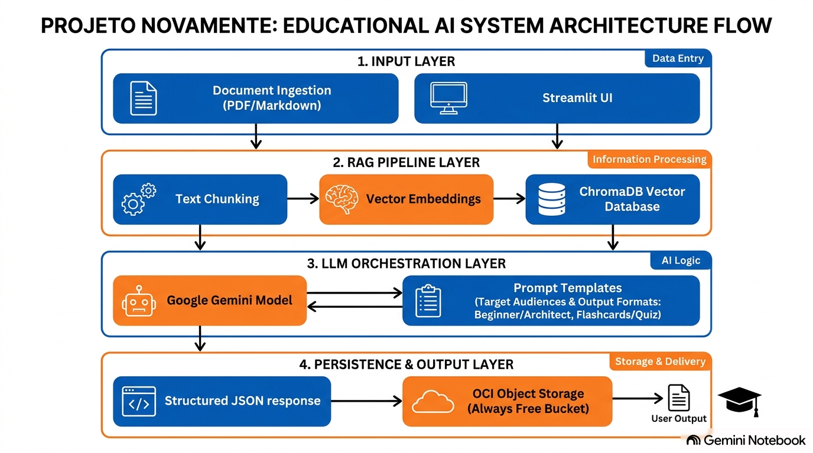
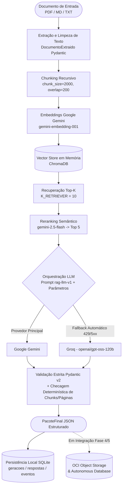

# MentorIA Tech — Equipe 26 | Hackathon ONE G10

<p align="center">
  
</p>

<p align="center">
  
  
  
  
  
  
</p>

<p align="center">
  <strong>Sistema inteligente de adaptação e geração de conteúdo educacional técnico ancorado em fontes reais via RAG.</strong>
</p>

<p align="center">
  <a href="#sobre-o-projeto">Sobre</a> •
  <a href="#problema-e-público-prioritário">Problema & Público</a> •
  <a href="#proposta-do-mvp-e-parametrização">Proposta do MVP</a> •
  <a href="#arquitetura-e-fluxo-do-pipeline">Arquitetura & Pipeline</a> •
  <a href="#status-real-das-funcionalidades">Status Real</a> •
  <a href="#cenários-de-demonstração">Cenários Demo</a> •
  <a href="#como-executar-localmente">Execução</a> •
  <a href="#equipe-26">Equipe 26</a>
</p>

---

## Sobre o projeto

O **MentorIA Tech** *(codinome inicial de desenvolvimento: NovaMente)* é a solução da **Equipe 26** para o **Hackathon ONE G10**, promovido pela **Oracle Next Education (ONE)** e pela **Alura** em parceria com a **NoCountry**.

A plataforma ingere documentações técnicas densas (manuais de software, guias de arquitetura em nuvem, artigos técnicos) e as transforma automaticamente em experiências de estudo estruturadas e personalizadas conforme o **perfil do estudante**, o **formato pedagógico**, o **nicho de aplicação** e o **nível de profundidade**, garantindo ancoragem estrita na documentação original por meio de **RAG (Retrieval-Augmented Generation)** e validação de contratos com **Pydantic v2**.

<p align="center">
  
</p>

---

## Problema e público prioritário

### O Problema
Empresas de tecnologia, comunidades técnicas e instituições de ensino produzem documentações ricas, porém extensas e repletas de jargões. Adaptar manualmente um mesmo guia técnico (como um manual de redes VCN na Oracle Cloud ou de Machine Learning) em diferentes formatos didáticos para públicos distintos consome semanas de especialistas e designers instrucionais. Por outro lado, o uso direto de LLMs genéricos sem controle de contexto gera alucinações e perda de rastreabilidade das fontes.

> **Pergunta norteadora:** *Como transformar documentação técnica complexa em conteúdos educacionais acessíveis, personalizados e estruturados em minutos, utilizando IA Generativa e RAG sem perder a fidelidade às fontes originais?*

### Público Prioritário
1. **Estudantes de tecnologia e profissionais em transição de carreira (Foco Primário):** pessoas que precisam compreender documentações oficiais densas com linguagem didática, analogias claras e formatos ativos de fixação (Flashcards, Passo a Passo, Quizzes).
2. **Desenvolvedores Júnior / Pleno e Tech Leads / Arquitetos:** profissionais que demandam sínteses técnicas aplicadas a nichos específicos (Fintech, Saúde, E-commerce, Geral) com rastreabilidade exata de páginas e trechos.
3. **Perfis Executivos / Gestores e EdTechs:** lideranças que necessitam de visões executivas (`TL;DR` / `Resumo`) para tomada de decisão rápida baseada em documentação técnica real.

---

## Proposta do MVP e parametrização

O MVP recebe **um documento técnico por execução** e combina o contexto recuperado via busca vetorial com parâmetros explícitos de personalização pedagógica.

### 1. Inputs suportados
* **Documento técnico:** arquivo `.pdf` (com camada de texto extraível), `.md` (Markdown) ou `.txt` (texto bruto).
  * *Nota técnica:* na `main`, a leitura de PDF opera via `pypdf` (`rag/extrator_temporario/`); o extrator multi-formato definitivo (`.pdf`, `.md`, `.txt` com `pdfplumber` e extração de tabelas) encontra-se em revisão no **PR #40**.
* **Idioma obrigatório do MVP:** **Português (PT-BR)**.

### 2. Perfis de destinatário
| Código no Schema (`schemas.py`) | Perfil na Interface / Negócio | Foco da Adaptação |
| :--- | :--- | :--- |
| `Iniciante` | Iniciante / Transição de Carreira | Linguagem acolhedora, explicação de conceitos-base e analogias. |
| `Jr/Pleno` | Desenvolvedor Júnior / Pleno | Aplicação prática, implementação, boas práticas e resolução de problemas. |
| `Arquiteto` *(em atualização para `Tech Lead`)* | Tech Lead / Arquiteto | Decisões de arquitetura, segurança, escalabilidade e trade-offs técnicos. |
| `Gestor` *(em atualização para `Executivo`)* | Executivo / Gestor | Visão estratégica, impacto de negócio, riscos e síntese executiva. |

### 3. Formatos pedagógicos de saída (6 formatos validados via Pydantic)
| Formato | Contrato Pydantic (`schemas.py`) | Estrutura Gerada |
| :--- | :--- | :--- |
| **Tutorial** | `Tutorial` (`PassoTutorial`) | Título e sequência de passos didáticos, cada um com explicação e fontes (`paginas`, `chunk_ids`). |
| **Flashcards** | `Flashcards` (`Flashcard`) | Lista de cartões com `pergunta`, `resposta`, `classificacao` (assunto, subassunto, dificuldade) e `fontes`. |
| **Quiz** | `Quiz` (`QuestaoQuiz`) | Questões com `enunciado`, 2 a 6 `alternativas` distintas, `indice_resposta_correta`, `explicacao`, `classificacao` e `fontes`. |
| **TL;DR** | `ResumoTLDR` | Síntese curta (`resumo`), lista de `pontos_chave` e `fontes` verificadas. |
| **Roteiro** | `Roteiro` (`EtapaRoteiro`) | Sequência de estudo/aula com `atividade`, `duracao_minutos` e `fontes`. |
| **Resumo** | `Resumo` (`SecaoResumo`) | Síntese estruturada por seções temáticas com `titulo`, `texto` e `fontes`. |

### 4. Nichos e níveis de detalhe
* **Nichos (`Nicho`):** `Geral`, `Fintech`, `Saúde`, `E-commerce`.
* **Níveis (`Dificuldade`):** `basico`, `intermediario`, `avancado` (mapeados na UI como *Sintético*, *Didático* e *Aprofundado*).

---

## Arquitetura e fluxo do pipeline

### Fluxograma Oficial da Solução (Arquitetura Geral)
<p align="center">
  
</p>

### Diagrama do Fluxo Técnico (Pipeline RAG + LLM + Persistência)


### Parâmetros Reais do Pipeline RAG (`rag/pipeline/rag_config.py`)
Selecionados após benchmark experimental com **200 combinações** (40 configurações × 5 documentos técnicos, avaliando *Precision*, *Recall*, *NDCG*, *MRR* e latência):
* **Chunk Size:** `2000` caracteres
* **Chunk Overlap:** `200` caracteres (10%)
* **K Retriever (Busca Vetorial ChromaDB):** `10` candidatos
* **Top N Reranker (Reclassificação LLM):** `5` trechos finais
* **Modelo de Embeddings:** `gemini-embedding-001`
* **Modelo de Reranking:** `gemini-2.5-flash`
* **Geração Principal:** Google Gemini (configurável via `GEMINI_MODEL`)
* **Fallback Automático:** Groq (`openai/gpt-oss-120b`, configurável via `GROQ_MODEL`)

---

## Tecnologias realmente utilizadas

| Camada | Tecnologias Implementadas na `main` | Status |
| :--- | :--- | :--- |
| **Linguagem & Contratos** | Python 3.11+ · Pydantic v2 (`pydantic>=2,<3`) | ✅ Implementado |
| **Extração de Documentos** | `pypdf` (na `main`) · `pdfplumber` multi-formato `.pdf/.md/.txt` (PR #40) | ✅ PDF na `main` / 🔄 Multi-formato em revisão |
| **RAG & Vector Store** | `langchain-core`, `langchain-community`, `langchain-text-splitters`, `chromadb` | ✅ Implementado |
| **Embeddings & LLMs** | `google-genai` (Gemini Embeddings, Reranker e Geração) · `groq` (Fallback) | ✅ Implementado |
| **Persistência Local & Telemetria** | `sqlite3` (`rag/database.py` e `rag/persistencia.py`) com anonimização SHA-256 e exportação CSV | ✅ Implementado |
| **Interface Web (Frontend)** | `streamlit` (`app/main.py`) com Brandbook UX/UI em 4 telas e exportação JSON/MD/CSV | ✅ Implementado (com mock local; integração com `rag/` em andamento) |
| **Benchmark Experimental** | `pandas`, `matplotlib`, `requests` (avaliação experimental em `rag/benchmark/`) | ✅ Implementado |
| **Cloud & Governança (OCI)** | OCI Object Storage Always Free, OCI Vault, IAM Policies e Autonomous Database | 📝 Proposta arquitetural e configuração controlada (Fases 4 e 5) |

---

## Estrutura atual do repositório

```text
G10-BRASIL-equipo-26/
├── .streamlit/config.toml                 # Configuração visual do Streamlit
├── app/                                   # [Front-end] Interface Streamlit em 4 telas
│   ├── main.py                            # Aplicação web interativa (atualmente com pipeline mock)
│   ├── README.md
│   └── README_da_interface_streamlit.md   # Guia de uso e pontos de conexão da interface
├── assets/                                # Ativos visuais oficiais e diagramas
│   ├── Logomarca_principal_1.webp         # Logo institucional MentorIA Tech
│   ├── mentoria-tech-logo-mascote-fundo-branco.jpg # Logo com mascote oficial
│   ├── Icone.webp                         # Ícone da aplicação
│   └── novamente_architecture_flowchart.png # Fluxograma de arquitetura
├── data/                                  # Schemas iniciais e referências de dados
│   ├── output_schema.json
│   └── README.md
├── docs/                                  # [Documentação Executiva, Arquitetura, OCI, QA e Atas]
│   ├── pitch.md                           # Pitch oficial e AI Canvas de referência
│   ├── arquitetura-mvp.md                 # Arquitetura detalhada e contratos de dados
│   ├── integracao-oci.md                  # Especificação IAM, Vault, Buckets e Autonomous DB
│   ├── oci-tutorial.md                    # Tutorial didático passo a passo para configuração OCI
│   ├── qa-plano.md                        # Plano de QA, 16 cenários de teste e método STAR
│   ├── metricas-kpis.md                   # Definição de métricas, KPIs e modelo para Power BI
│   ├── decisoes-e-status.md               # Rastreabilidade: Implementado vs Revisão vs Proposta vs Pós-MVP
│   ├── nocountry-entregavel.md            # Documento síntese obrigatório para a plataforma NoCountry
│   ├── guia-github-projects.md            # Guia prático de sincronização com o GitHub Projects
│   └── atas/                              # Atas de reunião da equipe (higienizadas conforme LGPD)
├── rag/                                   # [Back-end Core] Pipeline RAG, LLM, Pydantic, SQLite e Benchmark
│   ├── pipeline/
│   │   ├── schemas.py                     # Contratos Pydantic v2 (entrada, RAG, 6 formatos e saída)
│   │   ├── rag_config.py                  # Hiperparâmetros do RAG selecionados no benchmark
│   │   ├── rag_retrieval.py               # Indexação ChromaDB, embeddings e reranking Gemini
│   │   └── llm_pipeline.py                # Orquestração Gemini -> Fallback Groq + validação de fontes
│   ├── benchmark/                         # Scripts, notebooks e 15 CSVs de auditoria do benchmark RAG
│   ├── extrator_temporario/               # Extrator PDF provisório (pypdf)
│   ├── database.py                        # Persistência SQLite (geracoes, respostas, eventos_estudo)
│   ├── persistencia.py                    # Adaptador entre ResultadoPipeline e SQLite
│   ├── teste_integracao.py                # Execução integrada dos 6 formatos com PDF real
│   ├── visualizar_resultados_teste.ipynb  # Inspeção offline dos pacotes JSON gerados
│   ├── Machine_Learning.pdf               # Documento técnico de exemplo (16 páginas)
│   ├── requirements.txt                   # Dependências do núcleo RAG/LLM
│   └── .env.example                       # Modelo seguro de variáveis de ambiente (sem segredos)
├── agents/README.md                       # Diretório reservado para expansão de agentes
├── api/README.md                          # Diretório reservado para exposição REST
├── services/README.md                     # Diretório para conectores externos e OCI SDK
├── SECURITY.md                            # Política de divulgação responsável de vulnerabilidades
├── LICENSE                                # Licença MIT
└── README.md                              # Documentação principal do repositório
```

---

## Status real das funcionalidades

Para total transparência técnica perante a equipe e a banca avaliadora, o projeto adota a separação estrita abaixo (detalhada em [`docs/decisoes-e-status.md`](./docs/decisoes-e-status.md)):

| Categoria | Itens |
| :--- | :--- |
| **✅ IMPLEMENTADO (Funcional na `main`)** | • Pipeline RAG completo em `rag/pipeline/` (chunking 2000/200, `GeminiEmbeddings`, `ChromaDB`, reranking Gemini).<br>• Geração em **PT-BR** com **Google Gemini** e fallback automático para **Groq** (`openai/gpt-oss-120b`).<br>• Validação estrita com **Pydantic v2** para **6 formatos** (`Tutorial`, `Flashcards`, `Quiz`, `TL;DR`, `Roteiro`, `Resumo`) e verificação determinística de `chunk_ids` e páginas.<br>• Persistência local em **SQLite** (`rag/database.py`) para gerações, respostas de quiz (com limite de 3 tentativas por rodada) e eventos de estudo, sem coleta de PII.<br>• Benchmark RAG com 200 experimentos documentados em CSV e Jupyter Notebook.<br>• Interface **Streamlit** (`app/main.py`) com identidade visual completa em 4 telas e exportação em JSON, Markdown e CSV (Anki). |
| **🔄 EM REVISÃO** | • **PR #40 (`feature/extrator-fase2`):** Extrator definitivo multi-formato (`.pdf`, `.md`, `.txt`) com `pdfplumber` e extração de tabelas em Markdown.<br>• Padronização da nomenclatura dos perfis (`Tech Lead` e `Executivo`) e mensagens amigáveis para documentos sem contexto executivo ou sem camada de texto.<br>• Roteamento de múltiplas chaves de API (pool de chaves da equipe) para alta disponibilidade no Demo Day. |
| **📝 PROPOSTA (Documentada em `docs/`)** | • Governança IAM na OCI (`mentoria-tech-adm`, `mentoria-tech-dev`, `mentoria-tech-bi`, `mentoria-tech-viewer`) restrita ao compartimento `mentoria-tech`.<br>• Arquitetura privada de Buckets no **OCI Object Storage** (`mentoria-tech-documents`, `mentoria-tech-artifacts`, `mentoria-tech-observability`).<br>• Gestão de segredos via **OCI Vault** e modelagem relacional no **OCI Autonomous Database**. |
| **⏳ PENDENTE (Prioridade de Fechamento do MVP)** | • Conexão direta da interface `app/main.py` ao pipeline real `rag/pipeline/` (frente conduzida pelos desenvolvedores de integração da equipe).<br>• Ativação do upload real para o bucket **OCI Object Storage Always Free** substituindo o status `"pendente"`/`mock`.<br>• Inclusão da tabela `feedbacks` no banco para registro de avaliação do usuário por sessão. |
| **🚀 PÓS-MVP (Fora do escopo da entrega atual)** | • Conexão ativa de dashboards no **Power BI** (no MVP entregamos a modelagem de dados e exportação CSV).<br>• Idiomas **Espanhol** e **Inglês** (MVP focado 100% em **PT-BR**).<br>• Bot no **Telegram**, compartilhamento por **QR Code**, **IA Conversacional (chat livre)** e **OCR** para PDFs escaneados sem camada de texto. |

---

## Cenários de demonstração

Para atender ao requisito oficial do Hackathon ONE G10 de demonstrar pelo menos **três cenários distintos de adaptação** a partir de um mesmo documento técnico:

### Cenário 1 — Iniciante / Transição de Carreira + Flashcards (PT-BR)
* **Documento-base:** `rag/Machine_Learning.pdf` *(ou guia técnico de Redes VCN na OCI)*.
* **Parâmetros:** `perfil="Iniciante"`, `formato="Flashcards"`, `nicho="Geral"`, `nivel="basico"`.
* **Objetivo:** Apresentar conceitos fundamentais com linguagem acessível, definições claras de termos-base e cartões de revisão ancorados nas páginas originais.

### Cenário 2 — Desenvolvedor Júnior / Pleno + Tutorial Passo a Passo (PT-BR)
* **Documento-base:** O mesmo documento técnico utilizado no Cenário 1.
* **Parâmetros:** `perfil="Jr/Pleno"`, `formato="Tutorial"`, `nicho="Fintech"` (ou `Geral`), `nivel="intermediario"`.
* **Objetivo:** Estruturar um guia prático sequencial com etapas acionáveis de pré-processamento, construção e validação técnica, mantendo citação explícita de `chunk_ids` e páginas.

### Cenário 3 — Liderança Técnica / Executivo + Resumo Executivo ou Quiz (PT-BR)
* **Documento-base:** O mesmo documento técnico utilizado nos Cenários 1 e 2.
* **Parâmetros:** `perfil="Arquiteto"` (*Tech Lead*) ou `perfil="Gestor"` (*Executivo*), `formato="TL;DR"` / `Resumo` ou `Quiz`, `nicho="Geral"`, `nivel="avancado"`.
* **Objetivo:** Sintetizar decisões críticas, conceitos essenciais e verificação de domínio sem exigir leitura linear de todo o manual técnico.

---

## Requisitos oficiais do Hackathon ONE G10

| Requisito Oficial (Edital NoCountry / ONE G10) | Atendimento no Projeto |
| :--- | :--- |
| 1. Ingestão de documentos técnicos (PDF, Markdown ou texto) | Extrator PDF (`pypdf`) na `main` + Extrator multi-formato `.pdf/.md/.txt` no PR #40. |
| 2. Pipeline RAG com chunking, embeddings e busca vetorial | Implementado em `rag/pipeline/rag_retrieval.py` (`ChromaDB` + `gemini-embedding-001`). |
| 3. Orquestração com LLM para adaptação por perfil e formato | Implementado em `rag/pipeline/llm_pipeline.py` (Gemini + fallback Groq). |
| 4. Saída estruturada em JSON com validação de schema | Implementado em `rag/pipeline/schemas.py` com Pydantic v2. |
| 5. Adaptação comprovada para >= 2 perfis e >= 2 formatos | Suporte a 4 perfis e 6 formatos estruturados. |
| 6. Interface interativa (Streamlit/Gradio) ou API REST | Interface Streamlit em `app/main.py` (integração final com backend em andamento). |
| 7. Persistência no OCI Object Storage (Always Free) | Estrutura de dados pronta em `ArmazenamentoOCI` (`schemas.py`); configuração e cliente OCI documentados em `docs/integracao-oci.md` e `docs/oci-tutorial.md`. |
| 8. Documentação completa com diagrama de arquitetura e >= 3 exemplos | Entregue neste `README.md` e na pasta `docs/`. |

---

## Como executar localmente (sem expor credenciais)

> **Regra de Segurança:** Nunca grave chaves de API, tokens, OCIDs sensíveis ou senhas em arquivos versionados. Utilize exclusivamente variáveis de ambiente locais (`rag/.env`, ignorado pelo Git) ou segredos no OCI Vault.

### 1. Clonar o repositório e criar o ambiente virtual
No PowerShell (a partir da raiz do projeto):
```powershell
git clone https://github.com/No-Country-simulation/G10-BRASIL-equipo-26.git
cd G10-BRASIL-equipo-26
python -m venv .venv
.\.venv\Scripts\Activate.ps1
```

### 2. Executar a Interface Visual (Streamlit — Modo Demonstração Local sem Credenciais)
A interface atual em `app/main.py` pode ser inspecionada imediatamente sem necessidade de chaves de API externas:
```powershell
python -m pip install streamlit
streamlit run app/main.py
```

### 3. Inspecionar Resultados Reais do Pipeline RAG sem Consumir Tokens
Para visualizar os 6 pacotes JSON já gerados e validados pelo pipeline RAG/LLM sem realizar novas chamadas de API, abra o notebook:
```text
rag/visualizar_resultados_teste.ipynb
```

### 4. Executar o Pipeline Real (RAG + LLM + Pydantic + SQLite)
```powershell
# Instalar dependências do módulo RAG
python -m pip install -r .\rag\requirements.txt

# Copiar o template de variáveis de ambiente
Copy-Item .\rag\.env.example .\rag\.env
```
Edite o arquivo local `rag/.env` (que nunca deve ser commitado) informando suas chaves:
```dotenv
GEMINI_API_KEY=sua_chave_gemini_aqui
GROQ_API_KEY=sua_chave_groq_aqui
GEMINI_MODEL=gemini-2.5-flash
GROQ_MODEL=openai/gpt-oss-120b
```
Execute o teste integrado para gerar os 6 formatos pedagógicos e persistir os metadados no SQLite local:
```powershell
python .\rag\teste_integracao.py .\rag\Machine_Learning.pdf
```

---

## Documentação complementar (`docs/`)

* [**Pitch e AI Canvas (`docs/pitch.md`)**](./docs/pitch.md) — Proposta de valor, problema, solução, diferencial e limites do MVP.
* [**Engenharia de Prompts e Mercado (`docs/engenharia-prompts-e-mercado.md`)**](./docs/engenharia-prompts-e-mercado.md) — Frameworks de otimização de tokens (CO-STAR/RGC/Zero-Prose JSON), matriz de adaptação por Perfil/Formato/Nicho e análise competitiva de mercado.
* [**Arquitetura do MVP (`docs/arquitetura-mvp.md`)**](./docs/arquitetura-mvp.md) — Detalhamento dos módulos, contratos Pydantic, banco SQLite e pontos de integração.
* [**Integração OCI (`docs/integracao-oci.md`)**](./docs/integracao-oci.md) — Proposta técnica de IAM, Grupos, Policies, Vault, Object Storage e Autonomous Database.
* [**Tutorial Didático OCI (`docs/oci-tutorial.md`)**](./docs/oci-tutorial.md) — Guia passo a passo seguro para configuração da camada Always Free na OCI.
* [**Plano de QA e Método STAR (`docs/qa-plano.md`)**](./docs/qa-plano.md) — Estratégia de qualidade, 16 cenários de teste e validação STAR.
* [**Métricas e KPIs (`docs/metricas-kpis.md`)**](./docs/metricas-kpis.md) — Indicadores de performance técnica, qualidade RAG e preparação para Power BI (Pós-MVP).
* [**Decisões e Status (`docs/decisoes-e-status.md`)**](./docs/decisoes-e-status.md) — Matriz de governança e rastreabilidade do projeto.
* [**Entregável NoCountry (`docs/nocountry-entregavel.md`)**](./docs/nocountry-entregavel.md) — Documento oficial enxuto (< 10.000 caracteres) para submissão na plataforma.
* [**Guia GitHub Projects (`docs/guia-github-projects.md`)**](./docs/guia-github-projects.md) — Passo a passo para sincronizar branches, Issues e Pull Requests com o quadro `g10-equipo26`.
* [**Atas de Reunião (`docs/atas/`)**](./docs/atas/) — Registro histórico higienizado das decisões coletivas da Equipe 26.

---

## Equipe 26

| Integrante | Área(s) de Atuação no Projeto | GitHub | LinkedIn |
| :--- | :--- | :--- | :--- |
| **Lídia Moura (Lidi)** | Liderança Técnica · OCI/DevOps · Produto/Data/BI · QA/Documentação | [lidimoura](https://github.com/lidimoura) | [linkedin.com/in/lidimoura](https://linkedin.com/in/lidimoura/) |
| **Andrea Gonzalez** | Back-end/RAG/Agentes · Produto/Data/BI · Gestão Kanban | [AndreaGonzalez-cursoimersao](https://github.com/AndreaGonzalez-cursoimersao) | A adicionar |
| **João Okuyama** | Back-end/RAG/Agentes · Administração GitHub | [joao-okuyama](https://github.com/joao-okuyama) | A adicionar |
| **Josiane da Silva** | Back-end/RAG/Agentes · Produto/Data/BI · Front-end/UX | [josiane-silwa](https://github.com/josiane-silwa) | A adicionar |
| **Leonardo Santos** | Back-end/RAG/Agentes · Extração de Documentos · Produto/Data/BI | [souleosantos](https://github.com/souleosantos) | A adicionar |
| **Lysara Pinheiro** | Front-end/UX · Brandbook & Identidade Visual · QA/Documentação | [LysaJPDataLab](https://github.com/LysaJPDataLab) | A adicionar |
| **Rodrigo Silva** | Arquitetura RAG/LLM · Contratos Pydantic · Benchmark · SQLite | [prospera-analytics](https://github.com/prospera-analytics) | A adicionar |
| **Vagner Marques** | Produto/Data/BI · Schemas JSON · Integração CI/Projects | [DS-Vagner](https://github.com/DS-Vagner) | A adicionar |
| **Vinicius Ferreira** | Back-end/Ingestão · Arquitetura · OCI/DevOps · QA/Documentação | [fervinicius](https://github.com/fervinicius) | A adicionar |
| **Wagner Campos** | Front-end Streamlit · Back-end/RAG · OCI Tenancy | [wagnercampos5](https://github.com/wagnercampos5) | A adicionar |

---

## Nota de transparência sobre o uso estratégico de IA

A documentação técnica, a padronização arquitetural e a estruturação deste repositório contaram com o apoio estratégico de Inteligência Artificial como ferramenta de produtividade, auditoria de código e organização documental. Todas as decisões de produto, experimentos de benchmark, validações de negócio, escolhas de arquitetura e revisões finais foram conduzidas, testadas e aprovadas pelos integrantes da **Equipe 26**.

---

## Licença e controle de versão

* **Licença:** Este projeto está sob a licença [MIT](./LICENSE).
* **Responsável pela última atualização documental:** Lídia Moura (Lidi) — Líder Técnica (Equipe 26).
* **Data da última atualização:** 09/11/2026.
