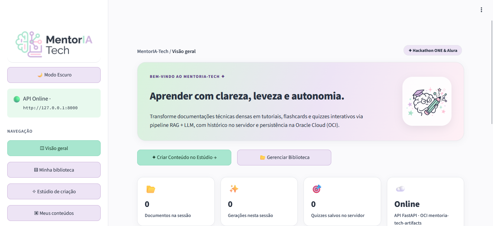
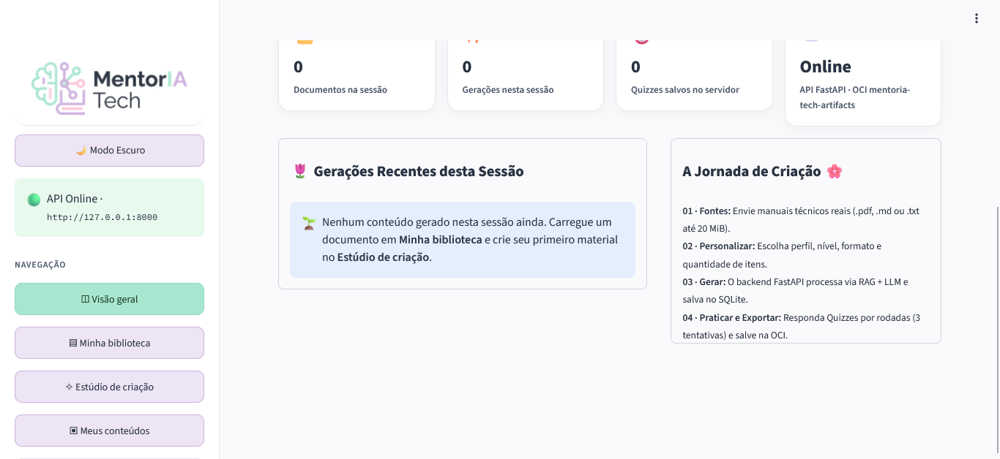
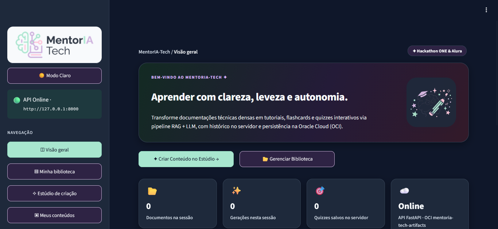
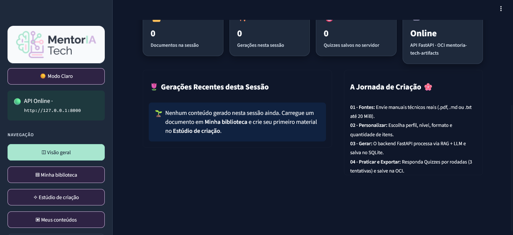
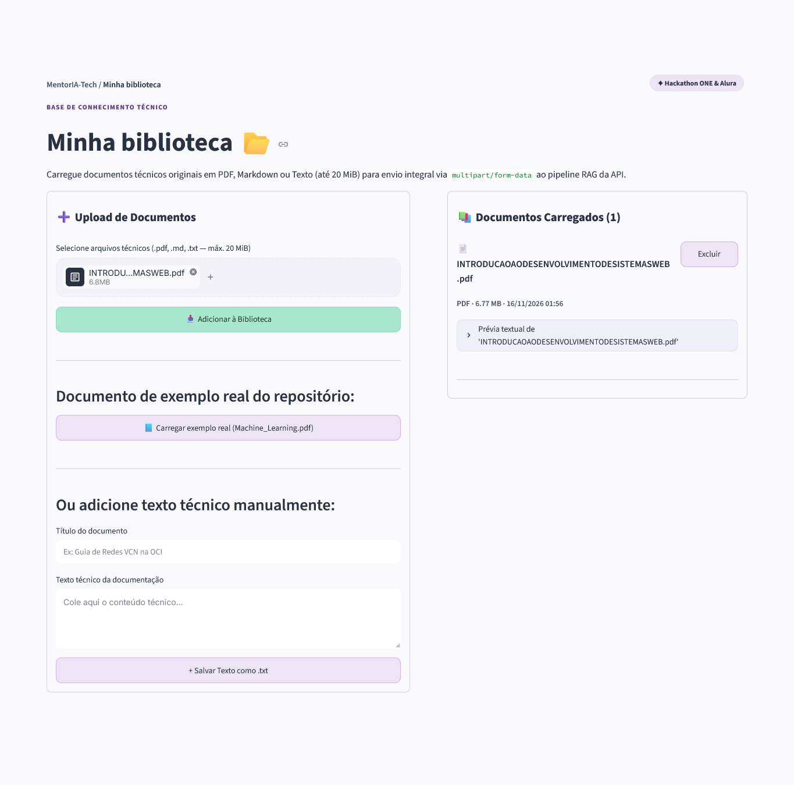
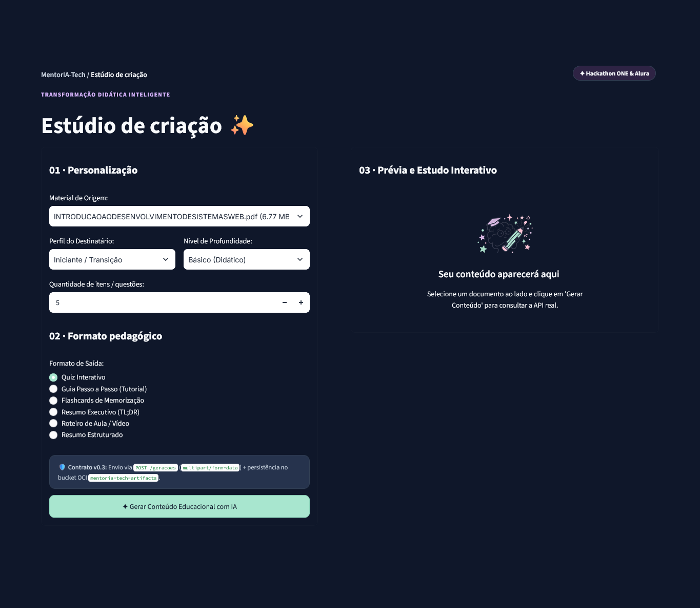
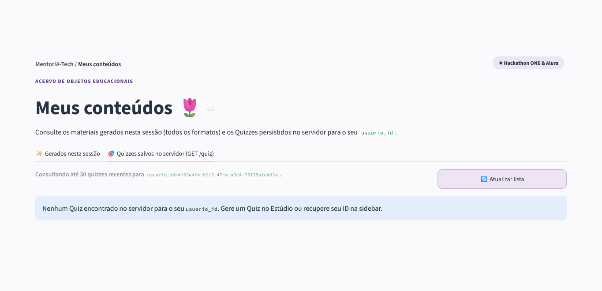
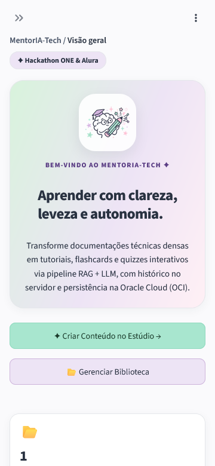
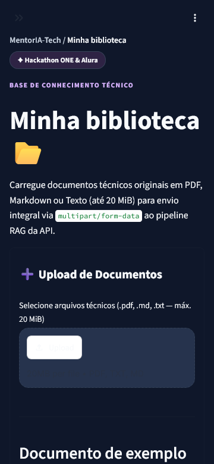

# 💻 Frontend Streamlit — MentorIA-Tech

Interface web oficial do **MentorIA-Tech**, desenvolvida em **Python + Streamlit** para o **Hackathon ONE G10 (Alura & Oracle)**, integrada via HTTP à API FastAPI (`rag/main.py`, contrato v0.3) e à persistência na nuvem **Oracle Cloud Infrastructure (OCI Object Storage — Always Free)**.

---

## 📌 Situação Atual

O frontend está **100% conectado à API real** e pronto para uso local e demonstração no Demo Day:

- **Comunicação real via HTTP:** Todas as gerações, listagens, rodadas, respostas e históricos do Quiz passam pelos endpoints da API FastAPI (`http://127.0.0.1:8000` por padrão, configurável via `MENTORIA_API_URL`).
- **Zero dados fictícios (*mocks*):** O gerador falso e os imports diretos do SQLite/RAG foram removidos; todo conteúdo exibido vem do pipeline RAG + LLM real do backend.
- **Persistência OCI oficial:** Os pacotes JSON gerados são enviados automaticamente ao bucket `mentoria-tech-artifacts` por meio de `services/oci_storage.py` (com *fallback* local automático em `data/oci_fallback/` caso a OCI não esteja configurada no ambiente).
- **UX/UI, Responsividade e Acessibilidade (WCAG AA):** Conta com **Modo Claro e Modo Escuro**, layout corrigido sem "cards fantasmas", adaptação *mobile-first* para telas de `360px`, imagens otimizadas com dimensões explícitas (baixo peso e zero CLS) e bloqueio do popup automático de tradução do navegador.

---

## 🕰️ O que foi feito (Evolução do Projeto)

### 1. Base do MVP (Construção Inicial)
- Definição da jornada de aprendizagem em **4 telas**: *Visão geral*, *Minha biblioteca*, *Estúdio de criação* e *Meus conteúdos*.
- Implementação da identidade visual oficial (**Brandbook UX/UI v1.1**): paleta Menta (`#A8E6CF`), Lilás (`#CDB4DB`), Rosa (`#FFC8DD`) e Grafite (`#293241`), tipografia *Inter*, recorte automático de margens da logomarca, ícone e mascote em `app/assets/`.
- Exportação dos materiais gerados em **JSON estruturado**, **Markdown** e **CSV compatível com Anki**.

### 2. Integração com o Contrato FastAPI v0.3 e OCI
- **Modularização da pasta `app/`:** O código monolítico inicial de ~1.500 linhas foi dividido em 7 módulos independentes e fáceis de manter (`config.py`, `api_client.py`, `identidade.py`, `oci_bridge.py`, `renderizadores.py`, `quiz_ui.py` e `main.py`).
- **Envio `multipart/form-data` real (`POST /geracoes`):** A *Biblioteca* passou a preservar os bytes originais dos arquivos `.pdf`, `.md` e `.txt` (até 20 MiB) — além de oferecer um botão rápido para carregar o arquivo real `rag/Machine_Learning.pdf`.
- **Alinhamento de parâmetros do contrato:** Ajuste do perfil `"Arquiteto"` para **`"Tech Lead"`** (evitando HTTP 422), remoção de campos não suportados (`instrucoes_adicionais` e `nicho`) e limite de **1 a 20 itens** na interface (padrão `5`) para evitar *timeouts* no Demo Day.
- **Identidade anônima (`usuario_id` e `sessao_id`):** Geração automática de UUIDs obrigatórios mantidos na URL (`?uid=`) + sincronização com `localStorage['novamente_usuario_id']` e `sessionStorage['novamente_sessao_id']`, com painel na sidebar para copiar ou recuperar um ID existente.
- **Máquina de estados do Quiz no servidor:** Remoção do cálculo local de acertos; o Quiz é carregado **sem gabarito**, exige início de rodada (`POST /quiz/rodadas`), envia cada tentativa para `POST /quiz/respostas` (até 3 tentativas por questão, revelando o gabarito somente no acerto ou no 3º erro), bloqueia tentativas após encerramento (HTTP `409`), evita reenvio local de alternativa já errada e exibe o histórico persistido no SQLite (`GET /quiz/{geracao_id}/historico`), além da listagem de quizzes salvos (`GET /quiz`).
- **Exportações seguras:** Os downloads em JSON, Markdown e CSV do Quiz nunca vazam o gabarito de questões ainda não encerradas pelo servidor.
- **Tratamento completo de erros e carregamento:** Mensagens amigáveis para HTTP `400`, `404`, `409`, `413`, `422`, `500`, `503` (suportando `detail` em texto ou lista Pydantic), falhas de conexão/`Timeout`, indicador de status da API (`GET /health`) na sidebar e proteção contra cliques duplicados durante a geração síncrona.
- **Integração OCI oficial:** Conexão direta com `services.oci_storage.enviar_resultado` e atualização de todas as referências do bucket para `mentoria-tech-artifacts`.

### 3. Refatoração de UX/UI, Dark Mode, Mobile e Lighthouse
- **Correção dos "Cards Fantasmas":** Substituição dos blocos `<div class="nm-card">` abertos/fechados ao redor de widgets por `with st.container(border=True):` estilizado via `[data-testid="stVerticalBlockBorderWrapper"]`, eliminando caixas vazias acima dos formulários.
- **Sistema de Temas Dinâmico (Claro / Escuro):** Botão instantâneo `🌙 Modo Escuro` / `☀️ Modo Claro` no topo da sidebar (`st.session_state["tema"]`), com paleta escura em Slate (`#0F172A` / `#1E293B`), contraste **WCAG AA (>= 4.5:1)** em ambos os modos e estilização dos inputs, selects, expanders e abas nativas do Streamlit.
- **Responsividade Mobile (`<= 768px`):** Layout *mobile-first* para telas de `360px` no banner `.nm-hero` (empilhamento vertical sem quebra de palavras no meio), padding lateral otimizado e botões de ação com `white-space: normal` (sem texto cortado com `...`).
- **Otimização Lighthouse (Acessibilidade, Performance e SEO):**
  - Redimensionamento e compressão em memória da logo e do mascote (`PIL.Image.thumbnail` + `optimize=True` em `@st.cache_data`), atributos `alt`, `width` e `height` explícitos e `min-height` fixo nos cards para zerar *Cumulative Layout Shift* (CLS).
  - Correção da hierarquia semântica de títulos (`h1` → `h2` → `h3`), remoção de `<h3>` em ícones de estatísticas e contraste corrigido nas legendas (`#4A5568` no claro e `#CBD5E1` no escuro).
  - Script no documento pai definindo `lang="pt-BR"`, `translate="no"`, classe `notranslate`, `<meta name="google" content="notranslate">` e `<meta name="description">`, impedindo o popup indevido de tradução do navegador.

---

## 🏗️ Arquitetura Modular (`app/`)

| Arquivo | Responsabilidade |
|---|---|
| [`app/main.py`](main.py) | Ponto de entrada do Streamlit: CSS dinâmico (Light/Dark + Mobile), assets otimizados, sidebar e roteamento das 4 telas |
| [`app/config.py`](config.py) | Constantes, URL da API (`MENTORIA_API_URL`), timeouts, limite de upload (20 MiB), bucket OCI e mapas de perfil/nível/formato |
| [`app/api_client.py`](api_client.py) | Cliente HTTP (`requests.Session`) para todos os endpoints da API v0.3 e tradução de erros HTTP/rede (`ApiError`) |
| [`app/identidade.py`](identidade.py) | Geração/recuperação de `usuario_id` e `sessao_id`, sincronização com `?uid=` e `localStorage`, e injeção de metas `pt-BR`/`notranslate` |
| [`app/oci_bridge.py`](oci_bridge.py) | Ponte para `services.oci_storage.enviar_resultado` (bucket `mentoria-tech-artifacts`) e formatação de status de upload |
| [`app/renderizadores.py`](renderizadores.py) | Renderização de cabeçalho, aviso de adequação pedagógica, citações RAG (`paginas` e `chunk_ids`), formatos não-Quiz, exportações e feedback local |
| [`app/quiz_ui.py`](quiz_ui.py) | Máquina de estados do Quiz no cliente: rodadas, até 3 tentativas via `@st.fragment`, bloqueio `409`, histórico do SQLite e gráficos por assunto |
| [`app/requirements.txt`](requirements.txt) | Dependências Python específicas do frontend Streamlit |
| [`.streamlit/config.toml`](../.streamlit/config.toml) | Tema base e limite de upload do servidor Streamlit (`maxUploadSize = 20`) |

---

## 🧭 Telas e Fluxo de Uso

1. **◫ Visão geral:** Apresentação do MentorIA-Tech, atalhos principais, indicadores da sessão (documentos, gerações, quizzes salvos no servidor e status da API/OCI) e lista de gerações recentes.
2. **▤ Minha biblioteca:** Upload de arquivos `.pdf`, `.md` ou `.txt` (até 20 MiB), botão de carregamento rápido do documento real `rag/Machine_Learning.pdf`, entrada manual de texto (salva como `.txt`) e prévia textual sob demanda.
3. **✧ Estúdio de criação:** Seleção do material, perfil (`Iniciante`, `Jr/Pleno`, `Tech Lead`, `Gestor`), nível (`basico`, `intermediario`, `avancado`), quantidade (`1` a `20`, padrão `5`), formato (`Quiz`, `Tutorial`, `Flashcards`, `TL;DR`, `Roteiro`, `Resumo`), acompanhamento do progresso síncrono, estudo interativo (com Quiz por rodadas e histórico) e exportação em JSON/Markdown/CSV Anki.
4. **▣ Meus conteúdos:**
   - *Gerados nesta sessão:* consulta completa de todos os formatos gerados na sessão atual (incluindo inspeção do JSON e status do upload na OCI).
   - *Quizzes salvos no servidor (`GET /quiz`):* lista até 30 quizzes recentes vinculados ao `usuario_id` atual, permitindo abrir no Estúdio ou jogar novas rodadas preservando o histórico no SQLite.

---

## 🛠️ Como Executar Localmente (Passo a Passo)

Para usar todas as funcionalidades, o **Backend (FastAPI)** e o **Frontend (Streamlit)** devem rodar em **dois terminais separados**.

### Pré-requisitos
- **Python 3.10+** instalado (recomendado usar ambiente virtual `.venv`).
- Arquivo `rag/.env` configurado com pelo menos uma chave da API Gemini (`GEMINI_API_KEY`) para que o pipeline RAG processe os documentos (use [`rag/.env.example`](../rag/.env.example) como modelo).

### Passo 1 — Criar/ativar o ambiente virtual (na raiz do repositório)

**Windows (PowerShell):**
```powershell
python -m venv .venv
.\.venv\Scripts\Activate.ps1
```

**Linux / macOS:**
```bash
python3 -m venv .venv
source .venv/bin/activate
```

### Passo 2 — Instalar as dependências
Se quiser rodar tanto a API quanto o Streamlit no mesmo ambiente virtual:
```bash
pip install -r requirements.txt -r app/requirements.txt
```
*(Ou, se for rodar apenas o frontend apontando para uma API remota, use `pip install -r app/requirements.txt`.)*

### Passo 3 — Terminal 1: Iniciar a API FastAPI
A API deve ser iniciada **a partir da pasta `rag/`**:
```bash
cd rag
python -m uvicorn main:app --reload
```
Quando estiver no ar, você verá a API rodando em `http://127.0.0.1:8000` (e a documentação Swagger em `http://127.0.0.1:8000/docs`).

### Passo 4 — Terminal 2: Iniciar a interface Streamlit
Em outro terminal (com o ambiente virtual ativado, na **raiz do repositório**):
```bash
streamlit run app/main.py
```
Acesse no navegador: **`http://localhost:8501`**.

> 💡 **Dica:** Na sidebar da interface, o indicador ficará **🟢 API Online** assim que o Terminal 1 estiver respondendo em `http://127.0.0.1:8000`.

---

## ⚙️ Configuração Opcional de URL da API e OCI (`secrets.toml`)

Caso queira apontar o frontend para uma API hospedada em outra máquina/nuvem (ex.: VM na OCI Compute) ou configurar credenciais da OCI no **Streamlit Cloud**, crie o arquivo `.streamlit/secrets.toml` na raiz do projeto (ele já está listado no `.gitignore` e nunca vai para o GitHub):

```toml
# Endereço da API FastAPI (padrão local: http://127.0.0.1:8000)
MENTORIA_API_URL = "http://127.0.0.1:8000"

# Configuração do OCI Object Storage (camada Always Free)
OCI_BUCKET_ARTIFACTS = "mentoria-tech-artifacts"
OCI_NAMESPACE = "seu_namespace_oci"
USE_OCI_VAULT = "false"
```

Para detalhes completos de configuração da OCI (PAR e SDK no Streamlit Cloud), consulte [docs/oci-tutorial.md](../docs/oci-tutorial.md) e o contrato completo da API em [docs/contrato-fastapi-frontend.md](../docs/contrato-fastapi-frontend.md).

---

## 🛡️ Tratamento de Erros e Limites Conhecidos

| Código / Situação | Significado no Frontend |
|---|---|
| **400** | Geração selecionada não é um Quiz ou a rodada expirou/pertence a outra sessão (limpa a rodada local e pede uma nova) |
| **404** | Quiz não encontrado ou associado a outro `usuario_id` |
| **409** | Tentativa bloqueada: questão já acertada ou limite de 3 tentativas atingido nesta rodada |
| **413** | Arquivo vazio ou maior que 20 MiB |
| **422** | Extensão de arquivo, perfil, nível, formato ou parâmetros inválidos |
| **500** | Erro interno no processamento do backend |
| **503** | Chave da API Gemini ausente no `rag/.env` |
| **Rede / Timeout** | API offline no endereço configurado ou geração excedeu 300s |

**Observação sobre conteúdos não-Quiz:** conforme o contrato v0.3, a API não expõe endpoint `GET` por ID para *Tutorial*, *Flashcards*, *TL;DR*, *Roteiro* ou *Resumo*. Por isso, esses formatos ficam disponíveis na aba *Gerados nesta sessão* e são persistidos em JSON na OCI (ou `data/oci_fallback/`).

---

## 🧪 Validação e Testes do Frontend

Para validar a sintaxe dos módulos e executar os testes unitários do cliente HTTP, OCI bridge e exportadores:

```bash
# 1. Verificação de sintaxe de todos os módulos do frontend
python -m py_compile app/config.py app/api_client.py app/identidade.py app/oci_bridge.py app/renderizadores.py app/quiz_ui.py app/main.py

# 2. Testes unitários isolados (sem precisar subir a API)
python -m unittest tests/test_frontend_api_client.py -v
```
---

## 🖼️ Galeria de Telas (Desktop, Dark Mode & Mobile)


### ☀️ Visão Geral — Modo Claro (Light Mode)
| Topo e Banner Hero | Indicadores e Jornada |
| :---: | :---: |
|  |  |

### 🌙 Visão Geral — Modo Escuro (Dark Mode)
| Topo e Banner Hero (Dark) | Indicadores e Jornada (Dark) |
| :---: | :---: |
|  |  |

### 🛠️ Fluxo de Trabalho (Biblioteca, Estúdio e Acervo)
| Minha Biblioteca (Upload & Prévia) | Estúdio de Criação (Dark Mode) | Meus Conteúdos (Acervo & Quizzes) |
| :---: | :---: | :---: |
|  |  |  |

### 📱 Responsividade Mobile (`360px`)
| Visão Geral Mobile (Light) | Minha Biblioteca Mobile (Dark) |
| :---: | :---: |
|  |  |