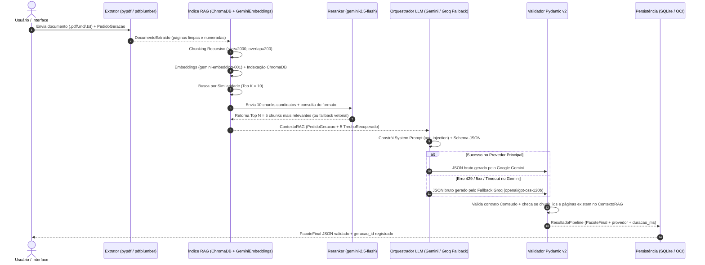

# Arquitetura Técnica do MVP — MentorIA Tech

**Responsável:** Lídia Moura (Lidi) — Líder Técnica (com contribuições de Rodrigo Silva, Vinicius Ferreira, Wagner Campos, Leonardo Santos e Vagner Marques)  
**Data da última atualização:** 09/11/2026  
**Status:** Documentação Técnica Oficial (Reflete o estado real da `main` + frentes em revisão)

---

## 1. Visão Geral da Arquitetura

O **MentorIA Tech** foi projetado em arquitetura modular desacoplada, separando claramente:
1. **Camada de Ingestão e Extração:** leitura de arquivos `.pdf`, `.md` e `.txt` e conversão para o contrato `DocumentoExtraido`.
2. **Camada de Indexação e Recuperação (RAG):** segmentação em chunks, geração de embeddings, busca vetorial no `ChromaDB` e reranking semântico.
3. **Camada de Orquestração LLM e Validação (Pydantic v2):** construção de prompts estruturados, chamada ao provedor principal (Google Gemini) com fallback automático (Groq) e validação determinística do JSON e das fontes citadas.
4. **Camada de Persistência e Telemetria:** armazenamento local em SQLite (`rag/database.py`) para execuções, interações de quiz e eventos de estudo, preparado para evolução com **OCI Object Storage** e **OCI Autonomous Database**.
5. **Camada de Apresentação (Frontend Streamlit):** interface web em 4 telas (`app/main.py`) seguindo o Brandbook oficial da equipe.

---

## 2. Fluxo Completo do Pipeline

---

## 3. Detalhamento dos Módulos Implementados (`rag/`)

### 3.1. Contratos de Dados (`rag/pipeline/schemas.py`)
Todos os modelos herdam da classe base `Estrito`, que define `ConfigDict(extra='forbid', str_strip_whitespace=True)` no Pydantic v2, impedindo campos extras ou malformados:
* **Entradas:**
  * `DocumentoEntrada`: `documento_id`, `nome_arquivo`, `tipo_arquivo` (`pdf`, `md`, `txt`).
  * `PedidoGeracao`: `documento`, `perfil` (`Iniciante`, `Jr/Pleno`, `Arquiteto`/`Tech Lead`, `Gestor`/`Executivo`), `formato` (`Tutorial`, `Flashcards`, `Quiz`, `TL;DR`, `Roteiro`, `Resumo`), `nicho` (`Fintech`, `Saúde`, `E-commerce`, `Geral`), `nivel`, `quantidade_itens` (1 a 100), `instrucoes_adicionais` e `politica_tokens`.
* **Recuperação RAG:**
  * `PaginaExtraida` e `DocumentoExtraido` (valida que não há páginas repetidas ou de documentos distintos).
  * `TrechoRecuperado` e `ContextoRAG` (garante que todos os trechos pertençam ao mesmo `documento_id` solicitado).
* **Saídas Pedagógicas (`Conteudo` — Discriminated Union por `formato`):**
  * `Tutorial` -> lista de `PassoTutorial` (`titulo`, `explicacao`, `fontes`).
  * `Flashcards` -> lista de `Flashcard` (`pergunta`, `resposta`, `classificacao`, `fontes`).
  * `Quiz` -> lista de `QuestaoQuiz` (`enunciado`, `alternativas` [2 a 6, sem duplicatas], `indice_resposta_correta`, `explicacao`, `classificacao`, `fontes`).
  * `ResumoTLDR` -> `resumo`, `pontos_chave`, `fontes`.
  * `Roteiro` -> lista de `EtapaRoteiro` (`atividade`, `duracao_minutos`, `fontes`).
  * `Resumo` -> `titulo`, lista de `SecaoResumo` (`titulo`, `texto`, `fontes`).
* **Envelope de Saída (`PacoteFinal`):**
  * `metadados` (`Metadados`), `conteudo_adaptado` (`Conteudo`), `avaliacao_qualidade` (`AvaliacaoQualidade`) e `armazenamento_oci` (`ArmazenamentoOCI`).

### 3.2. Configuração e Recuperação RAG (`rag/pipeline/rag_config.py` e `rag_retrieval.py`)
* **Context Manager `indice_documento(documento)`:** Cria uma coleção efêmera em memória no `ChromaDB` (`nm_<uuid>`), indexando o documento uma única vez e permitindo gerar múltiplos formatos na mesma sessão sem reindexar.
* **Batching de Embeddings:** A classe `GeminiEmbeddings` processa textos em lotes de até 16 itens com `task_type='RETRIEVAL_DOCUMENT'` para indexação e `'RETRIEVAL_QUERY'` para busca.
* **Reranking Resiliente (`_reranquear_gemini`):** Solicita ao modelo `gemini-2.5-flash` (`temperature=0`, `response_mime_type='application/json'`) a seleção ordenada dos `5` melhores trechos dentre os `10` recuperados. Se o reranker falhar ou retornar IDs inválidos, o pipeline degrada graciosamente mantendo a ordem original da busca vetorial do ChromaDB.

### 3.3. Orquestração LLM e Guardrails (`rag/pipeline/llm_pipeline.py`)
* **Proteção contra Prompt Injection:** Tanto o reranker quanto o gerador instruem explicitamente o modelo a tratar os trechos recuperados do documento como **dados não confiáveis**, ignorando comandos embutidos no PDF/texto.
* **Controle de Janela de Contexto (`_contexto_texto`):** Limita o texto enviado em `NOVAMENTE_MAX_CONTEXT_CHARS` (padrão `28.000` caracteres), truncando apenas o corpo final sem jamais corromper o cabeçalho `[CHUNK id=... paginas=...]`.
* **Validação Determinística de Referências (`_validar_conteudo`):** Além de validar o JSON contra o schema Pydantic, verifica matematicamente se:
  1. Todo item gerado possui `fontes` com `chunk_ids` não vazios;
  2. Todos os `chunk_ids` citados pela LLM realmente existem no `ContextoRAG` enviado;
  3. Todas as páginas citadas pertencem ao conjunto de páginas dos `chunk_ids` referenciados.

### 3.4. Persistência Local e Privacidade (`rag/database.py` e `rag/persistencia.py`)
* Banco SQLite configurável via variável `NOVAMENTE_DB_PATH` (padrão `rag/novamente.db`).
* **Tabelas implementadas:**
  * `geracoes`: armazena os metadados da execução, modelo LLM utilizado, duração em milissegundos e o `pacote_json` completo.
  * `respostas`: registra cada tentativa de resposta do aluno no Quiz (máximo de 3 tentativas por questão/rodada), calculando `assunto_id` e `questao_referencia_id` com hash determinístico SHA-256 (`stable_id`).
  * `eventos_estudo`: registra telemetria de navegação e interação com os itens gerados.
* **Exportação Tabular:** Função `export_csv(table)` pronta para extração limpa sem expor payloads pesados ou dados pessoais.

---

## 4. Ponto de Atenção Arquitetural: Integração Frontend (`app/main.py`) ↔ Backend (`rag/`)

> **Status Atual:** `EM INTEGRAÇÃO PELA EQUIPE DE FRONTEND/BACKEND` (Não alterado nesta branch documental, conforme diretriz de governança).

1. **Estado atual de `app/main.py`:** A interface Streamlit implementa toda a identidade visual e as 4 telas (*Visão geral*, *Minha biblioteca*, *Estúdio de criação* e *Meus conteúdos*), mas executa internamente a função mockada `executar_pipeline_novamente()`, cujo retorno segue o formato preliminar de `data/output_schema.json` (onde todos os formatos usam `itens` com `frente`, `verso` e `dica_didatica`).
2. **Estado atual de `rag/pipeline/schemas.py`:** O pipeline real gera estruturas específicas e ricas para cada formato (`passos` para Tutorial, `itens` com `pergunta`/`resposta` para Flashcards, `questoes` para Quiz, `resumo`/`pontos_chave` para TL;DR, `etapas` para Roteiro e `secoes` para Resumo).
3. **Recomendação Técnica para a Frente de Integração Frontend/Backend:**
   * Na função de renderização do `app/main.py` (`renderizar_previa_conteudo`), adaptar a leitura de `conteudo_adaptado` para inspecionar o discriminador `formato` do `PacoteFinal` (ou criar um pequeno *adapter* de visualização que traduza `PassoTutorial`, `Flashcard`, `QuestaoQuiz`, `ResumoTLDR`, `EtapaRoteiro` e `SecaoResumo` para os componentes visuais do Streamlit).
