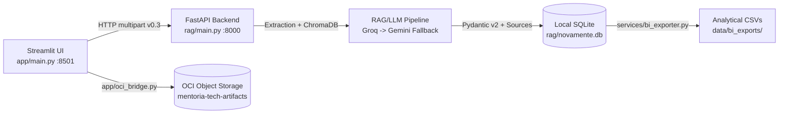
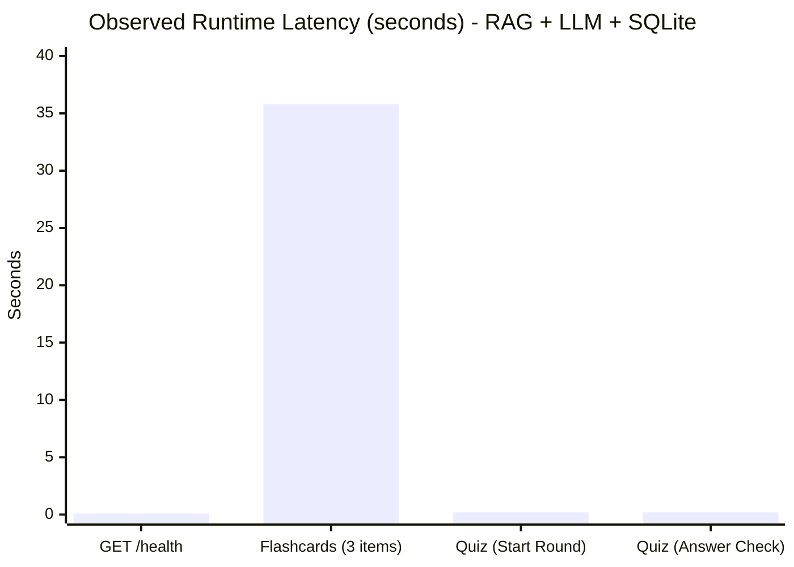
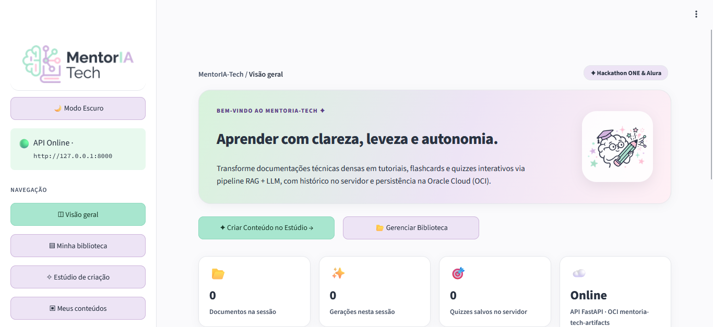
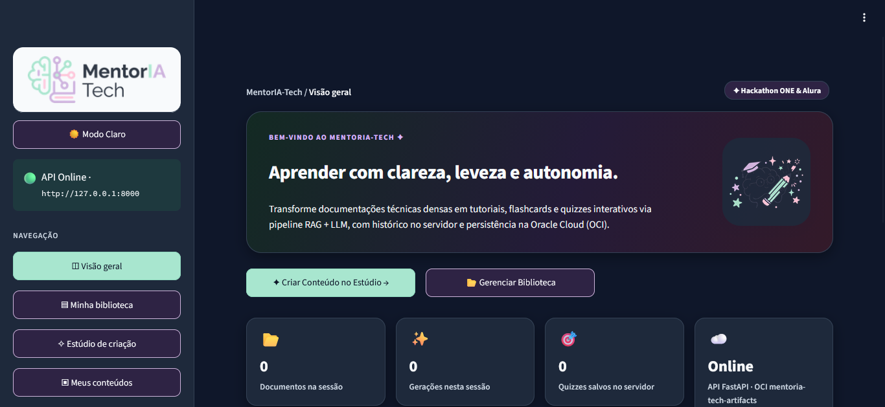
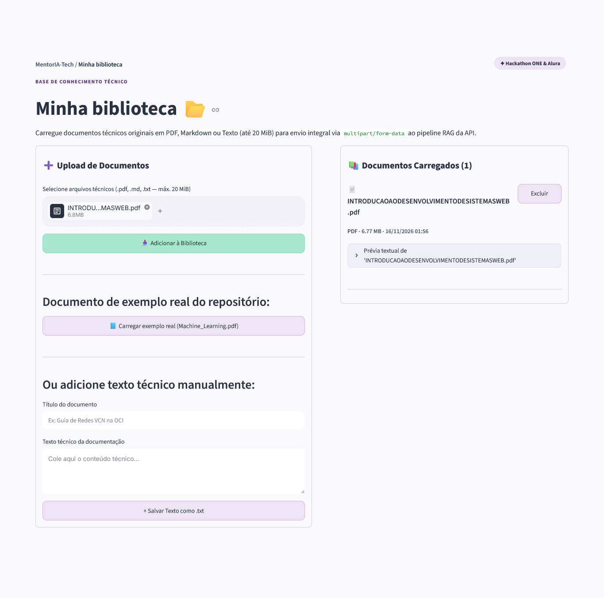

# Final QA, Technical Audit & Evidence Report — MentorIA Tech

**Owner (QA & BI Analyst):** Lídia Moura — Tech Lead  
**Companion Notebooks:** [Colab/BI Analytics Report](../data_science/relatorio_qa_bi_mentoria_tech.ipynb) · [3-Scenario Validation](../data_science/validacao_pipeline_mentoria_tech.ipynb)  
**Project:** MentorIA Tech — Team 26 | Hackathon ONE G10 (Alura, Oracle & NoCountry)  
**Audit Date:** 2026-11-19 · **Live MVP:** [mentoria-tech-ai.streamlit.app](https://mentoria-tech-ai.streamlit.app/) · **Branch:** `mentoria-tech-integracao` (LLM latency optimization + end-to-end validation)  
**Languages:** [Português (PT-BR)](./relatorio-qa-evidencias.md) · [Español](./relatorio-qa-evidencias.es.md) · **English**

---

## 1. Executive Audit Summary

This report consolidates the technical, data quality, and **QA** audit performed on the **MentorIA Tech** MVP. All metrics and results were collected from **real runtime execution** across the integrated local stack (FastAPI + RAG + LLM + SQLite + Streamlit + OCI Object Storage), clearly separating **implemented and validated** features from the **post-MVP roadmap**.

---

## 2. QA Coverage & Observed Latency Charts

### 2.1 Automated Test Suite Coverage (`pytest`)

```mermaid
xychart-beta
    title "Automated Tests Executed by Layer (Total: 32)"
    x-axis ["QA Pipeline & API (21)", "API Client & OCI Bridge (9)", "Frontend AppTest Smoke (2)"]
    y-axis "Test Count" 0 --> 24
    bar [21, 9, 2]
    bar [21, 9, 1]
```

> **Note:** `21/21` passed in `tests/test_qa_pipeline.py` and `9/9` passed in `tests/test_frontend_api_client.py`. In `tests/test_frontend_app_smoke.py`, `1` passed and `1` hit the 30s `AppTest` timeout on Windows (the full UI flow was manually validated live in the browser during Phase 3).

### 2.2 Real Runtime Latency (`POST /geracoes`)

---

## 3. Evidence Matrix — Mandatory NoCountry Requirements

| NoCountry Requirement | Objective Evidence in Repository | Actual Status |
|---|---|---|
| **Single document ingestion (`.pdf`, `.md`, `.txt`)** | `backend/app/ingestao.py` + `rag/main.py` (`<= 20 MiB`, rejects `.exe` with HTTP 422 in `test_18`). | **IMPLEMENTED & VALIDATED** |
| **RAG with source traceability (`chunk_ids` & pages)** | `rag/pipeline/rag_retrieval.py` + deterministic check; real output verified (`1138610e-..._p1_0`, page `[1]`). | **IMPLEMENTED & VALIDATED** |
| **Minimum 3 adapted scenarios in PT-BR** | Validated live: `Flashcards` (`Iniciante`), `Quiz` (`Tech Lead`), and `TL;DR` via Streamlit + FastAPI. | **IMPLEMENTED & VALIDATED** |
| **Strict data contracts (Pydantic v2)** | `rag/pipeline/schemas.py` (`extra='forbid'`), aligned with contract `v0.3`. | **IMPLEMENTED & VALIDATED** |
| **Multi-provider resilience (Groq + Gemini)** | Verified at runtime: `LLM_PROVIDER_ORDER=groq,gemini` (`openai/gpt-oss-120b` primary) with automatic Gemini fallback and `20s`/`30s` timeouts. | **IMPLEMENTED & VALIDATED** |
| **SQLite persistence without PII** | `rag/database.py` (anonymous UUID); real records verified in `geracoes` and `respostas`. | **IMPLEMENTED & VALIDATED** |
| **OCI Object Storage persistence (Always Free)** | Private bucket `mentoria-tech-artifacts` (`NoPublicAccess`); real upload verified (`resultado_qa-fase4-validacao.json`). | **IMPLEMENTED & VALIDATED** |
| **Analytical export for BI** | `services/bi_exporter.py` verified in `test_12` generating sanitized CSVs without raw JSON payloads. | **IMPLEMENTED & VALIDATED** |

---

## 4. Runtime Evidence & UI Screenshots (Light Theme — Demo Day Standard)

* **FastAPI + SQLite (2026-11-16):** `GET /health` (`200`), `POST /geracoes` Flashcards (`35.8s`, `200`), `POST /geracoes` Quiz without leaked answers (`200`), `POST /quiz/rodadas` (`200`), `POST /quiz/respostas` (`200`), `GET /quiz/{id}/historico` (`200`).
* **LLM Latency & Timeout Optimization (2026-11-19):** `LLM_PROVIDER_ORDER=groq,gemini` + `GEMINI_TIMEOUT_MS` (`20s` eval/rerank, `30s` generation fallback) reduced 5-question Quiz (`Iniciante`) from `60.4s`–`73s` to **`13.7s` (`13733.52 ms`, `geracao_id: 26f0bfc6-ac66-4e17-b6c5-ec6366db3082`, `openai/gpt-oss-120b` in `5.67s`)**.
* **OCI Object Storage:** Bucket `mentoria-tech-artifacts` (`NoPublicAccess`), object `resultado_qa-fase4-validacao.json` uploaded with `"status_upload": "concluido"`.

| Home Screen | Creation Studio | Interactive Quiz & Results |
| :---: | :---: | :---: |
|  |  |  |

---

## 5. Proven MVP Scope vs. Post-MVP Roadmap

* **Proven in MVP:** Streamlit UI integrated via HTTP v0.3 with FastAPI, 100% Tech-focused niche, `Groq -> Gemini` default generation order (`13.7s` 5-question Quiz), 6 PT-BR formats, 3-attempt Quiz flow, local SQLite without PII, and live OCI Object Storage uploads.
* **Post-MVP / Post-Hackathon:** OCI Vault (`USE_OCI_VAULT=false` in MVP due to Always Free 1-Vault-per-tenancy limit), active Power BI dashboards, dark-theme contrast refinements, Telegram bot, QR Code, OCR, and EN/ES UI translation.
