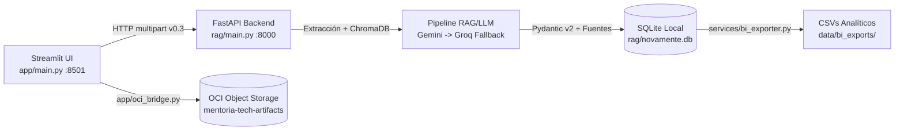
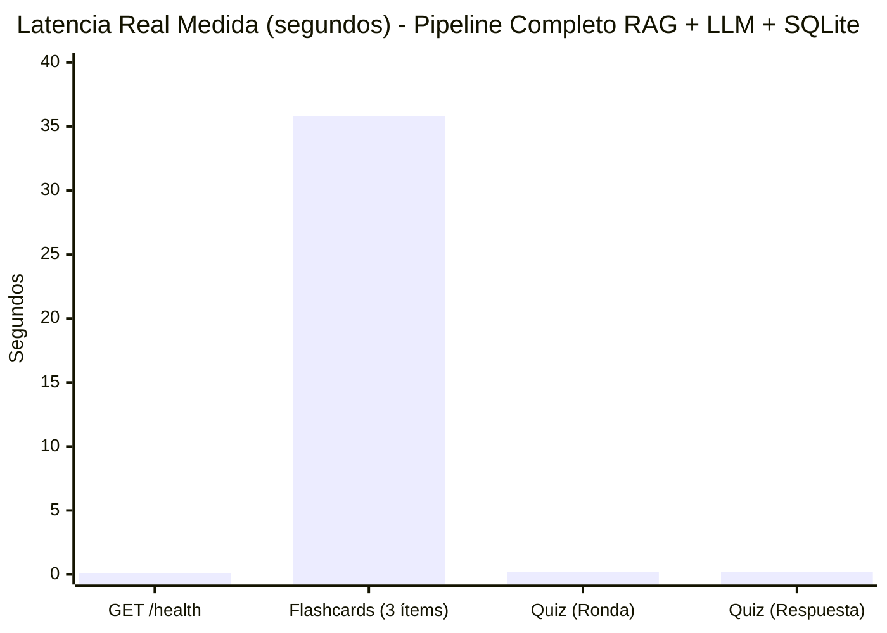
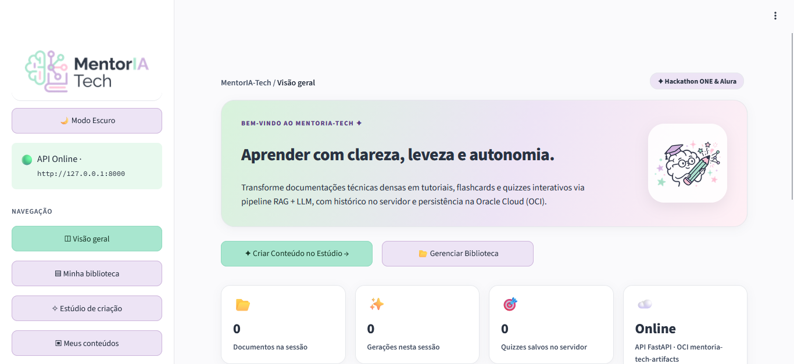
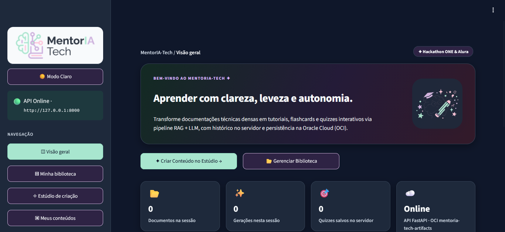
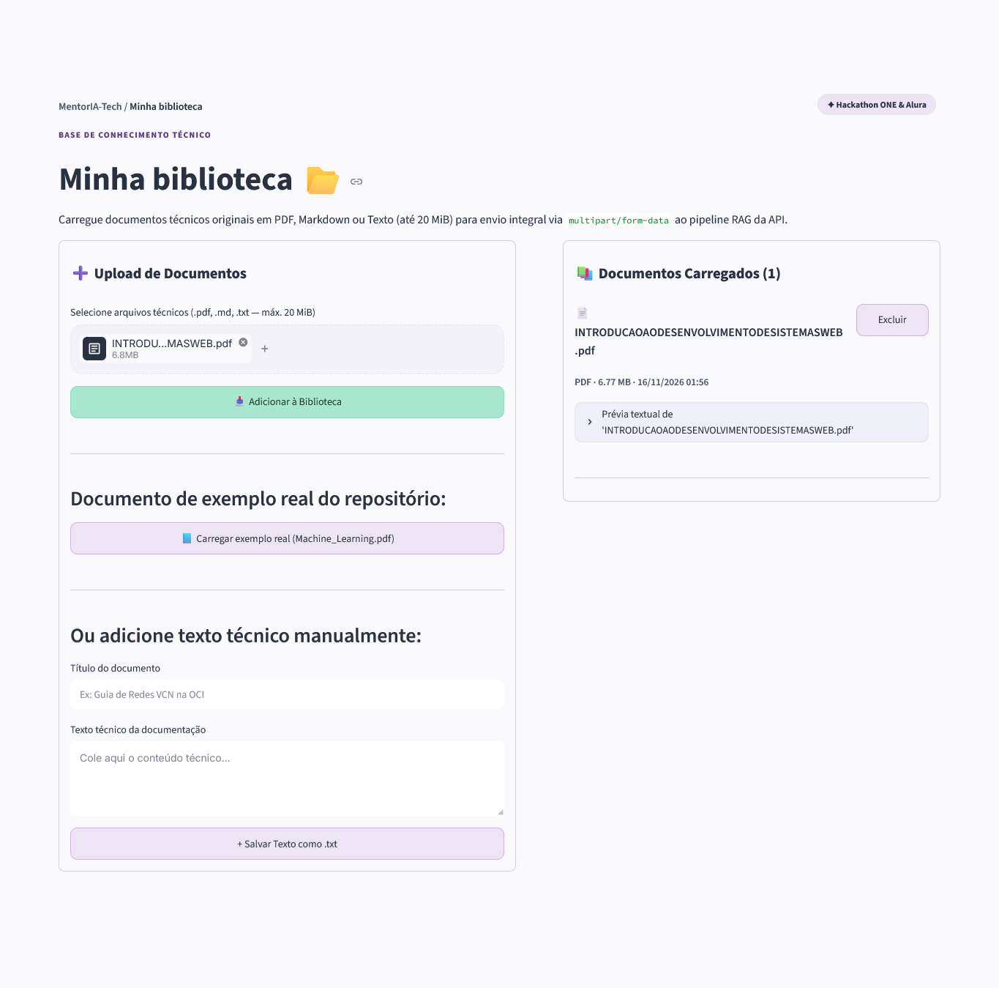

# Informe Final de QA, Auditoría Técnica y Evidencias — MentorIA Tech

**Responsable (QA & BI Analyst):** Lídia Moura — Líder Técnica  
**Notebooks Complementarios:** [Informe Analítico Colab/BI](../rag/notebooks/relatorio_qa_bi_mentoria_tech.ipynb) · [Validación de 3 Escenarios](../rag/notebooks/validacao_pipeline_mentoria_tech.ipynb)  
**Proyecto:** MentorIA Tech — Equipo 26 | Hackathon ONE G10 (Alura, Oracle & NoCountry)  
**Fecha de Auditoría:** 18/11/2026 · **MVP Online:** [mentoria-tech-ai.streamlit.app](https://mentoria-tech-ai.streamlit.app/) · **Rama:** `main` (`1728829` + validación de extremo a extremo)  
**Idiomas:** [Português (PT-BR)](./relatorio-qa-evidencias.md) · **Español** · [English](./relatorio-qa-evidencias.en.md)

---

## 1. Resumen Ejecutivo de la Auditoría

Este informe consolida la auditoría técnica, de datos y de calidad (**QA & Data Quality**) realizada sobre el MVP de **MentorIA Tech**. Todas las métricas y resultados se recopilaron en **ejecución real** sobre el entorno local integrado (FastAPI + RAG + LLM + SQLite + Streamlit + OCI Object Storage), manteniendo transparencia total entre lo que está **implementado y validado** y el **roadmap post-MVP**.

---

## 2. Gráficos de Cobertura de QA y Rendimiento Observado

### 2.1 Cobertura de la Suite Automatizada (`pytest`)

```mermaid
xychart-beta
    title "Pruebas Automatizadas Ejecutadas por Capa (Total: 30)"
    x-axis ["QA Pipeline y API (19)", "API Client y OCI Bridge (9)", "Frontend AppTest Smoke (2)"]
    y-axis "Cantidad de Pruebas" 0 --> 22
    bar [19, 9, 2]
    bar [19, 9, 1]
```

> **Lectura:** `19/19` aprobadas en `tests/test_qa_pipeline.py` y `9/9` en `tests/test_frontend_api_client.py`. En `tests/test_frontend_app_smoke.py`, `1` prueba pasó y `1` alcanzó el timeout de 30s de `AppTest` en Windows (flujo validado manualmente en vivo en el navegador en la Fase 3).

### 2.2 Tiempos de Respuesta Observados en Ejecución Real (Backend `POST /geracoes`)

---

## 3. Matriz de Evidencias — Requisitos Obligatorios NoCountry

| Requisito NoCountry | Evidencia Objetiva en el Proyecto | Estado Real |
|---|---|---|
| **Documento único (`.pdf`, `.md`, `.txt`)** | `backend/app/ingestao.py` + `rag/main.py` (`<= 20 MiB`, rechaza `.exe` con HTTP 422 en `test_18`). | **IMPLEMENTADO Y VALIDADO** |
| **RAG con trazabilidad (`chunk_ids` y páginas)** | `rag/pipeline/rag_retrieval.py` + validación determinista; retorno real (`1138610e-..._p1_0`, pág. `[1]`). | **IMPLEMENTADO Y VALIDADO** |
| **Mínimo 3 escenarios/formatos en PT-BR** | Validados en vivo: `Flashcards` (`Iniciante`), `Quiz` (`Tech Lead`) y `TL;DR` vía Streamlit + FastAPI. | **IMPLEMENTADO Y VALIDADO** |
| **Contrato estricto de datos (Pydantic v2)** | `rag/pipeline/schemas.py` (`extra='forbid'`), alineado al contrato `v0.3`. | **IMPLEMENTADO Y VALIDADO** |
| **Resiliencia multi-proveedor (Gemini + Groq)** | Comprobado en ejecución real: fallback automático a `openai/gpt-oss-120b` sin caída del servicio. | **IMPLEMENTADO Y VALIDADO** |
| **Persistencia SQLite sin PII** | `rag/database.py` (UUID anónimo); registros reales confirmados en `geracoes` y `respostas`. | **IMPLEMENTADO Y VALIDADO** |
| **Persistencia en OCI Object Storage (Always Free)** | Bucket privado `mentoria-tech-artifacts` (`NoPublicAccess`); carga real confirmada (`resultado_qa-fase4-validacao.json`). | **IMPLEMENTADO Y VALIDADO** |
| **Exportación analítica para BI** | `services/bi_exporter.py` validado en `test_12` generando CSVs limpios sin payloads JSON crudos. | **IMPLEMENTADO Y VALIDADO** |

---

## 4. Evidencias de Ejecución y Pantalla (Tema Claro — Demo Day)

* **FastAPI + SQLite (16/11/2026):** `GET /health` (`200`), `POST /geracoes` Flashcards (`35.8s`, `200`), `POST /geracoes` Quiz sin respuestas correctas expuestas (`200`), `POST /quiz/rodadas` (`200`), `POST /quiz/respostas` (`200`), `GET /quiz/{id}/historico` (`200`).
* **OCI Object Storage:** Bucket `mentoria-tech-artifacts` (`NoPublicAccess`), objeto `resultado_qa-fase4-validacao.json` con `"status_upload": "concluido"`.

| Pantalla Inicial | Estudio de Creación | Quiz y Resultado |
| :---: | :---: | :---: |
|  |  |  |

---

## 5. Alcance Comprobado (MVP) vs. Roadmap Post-MVP

* **Comprobado en el MVP:** Interfaz Streamlit integrada por HTTP v0.3 con FastAPI, nicho 100% en Tecnología, 6 formatos en PT-BR, Quiz con 3 intentos, SQLite local sin PII y carga real a OCI Object Storage.
* **Post-MVP / Post-Hackathon:** OCI Vault (`USE_OCI_VAULT=false` en el MVP por límite de 1 Vault en Always Free), paneles activos en Power BI, inversión de orden `Groq -> Gemini`, ajustes de contraste en tema oscuro, Telegram, QR Code, OCR y traducción de la UI.
