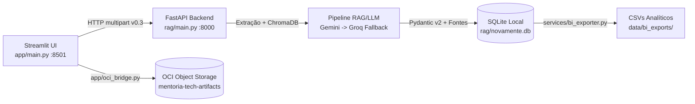
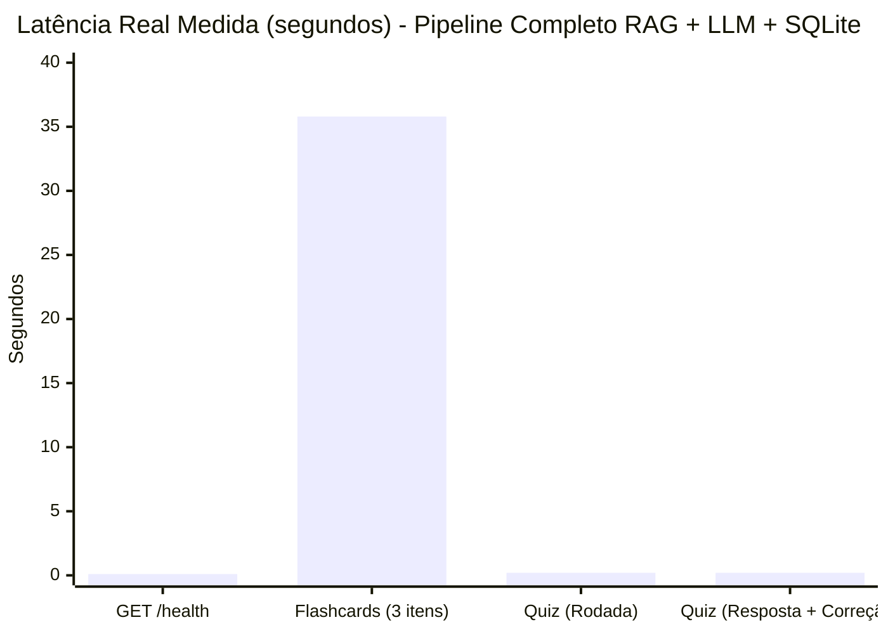
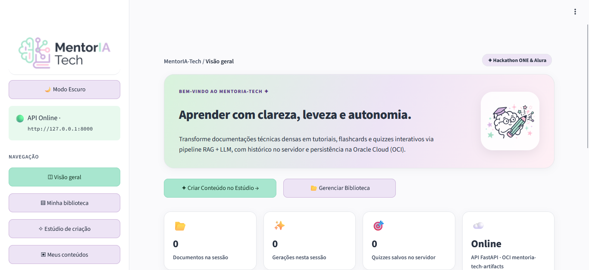
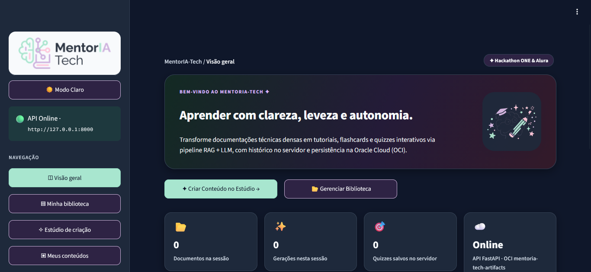
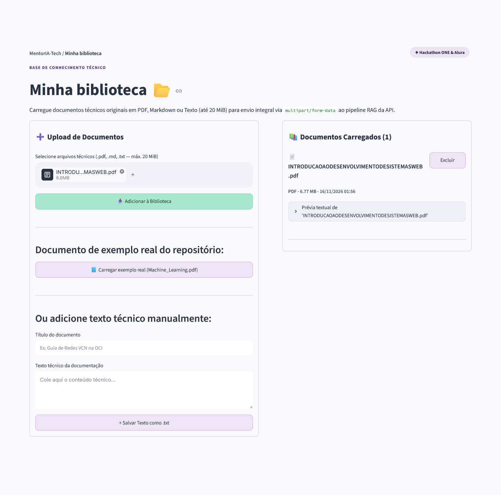

# Relatório Final de QA, Auditoria Técnica e Evidências — MentorIA Tech

**Responsável (QA & BI Analyst):** Lídia Moura — Líder Técnica  
**Notebooks Complementares:** [Relatório Analítico Colab/BI](../rag/notebooks/relatorio_qa_bi_mentoria_tech.ipynb) · [Validação dos 3 Cenários](../rag/notebooks/validacao_pipeline_mentoria_tech.ipynb)  
**Projeto:** MentorIA Tech — Equipe 26 | Hackathon ONE G10 (Alura, Oracle & NoCountry)  
**Data da Auditoria:** 16/11/2026 · **Branch de referência:** `main` (`b061126` + validação ponta a ponta)  
**Idiomas:** **Português (PT-BR)** · [Español](./relatorio-qa-evidencias.es.md) · [English](./relatorio-qa-evidencias.en.md)

---

## 1. Resumo Executivo da Auditoria

Este relatório consolida a auditoria técnica, de dados e de qualidade (**QA & Data Quality**) realizada sobre o MVP do **MentorIA Tech**. Todas as métricas e resultados abaixo foram coletados em **execução real** no ambiente local integrado (FastAPI + RAG + LLM + SQLite + Streamlit + OCI Object Storage), garantindo rastreabilidade e transparência absoluta entre o que está **implementado e validado** e o que pertence ao **roadmap pós-MVP**.



---

## 2. Gráficos de Cobertura de QA e Desempenho Observado

### 2.1 Cobertura da Suíte Automatizada (`pytest`)

```mermaid
xychart-beta
    title "Testes Automatizados Executados por Camada (Total: 30)"
    x-axis ["QA Pipeline & API (19)", "API Client & OCI Bridge (9)", "Frontend AppTest Smoke (2)"]
    y-axis "Quantidade de Testes" 0 --> 22
    bar [19, 9, 2]
    bar [19, 9, 1]
```



> **Leitura do gráfico:** Barras totais = testes definidos; barras validadas = testes aprovados (`19/19` em `tests/test_qa_pipeline.py` e `9/9` em `tests/test_frontend_api_client.py`). Em `tests/test_frontend_app_smoke.py`, `1` teste passou e `1` atingiu timeout de 30s do `AppTest` no Windows (fluxo validado manualmente ao vivo no navegador na Fase 3).

### 2.2 Tempos de Resposta Observados em Execução Real (Backend `POST /geracoes`)



---

## 3. Matriz de Evidências — Requisitos Obrigatórios NoCountry

| Requisito NoCountry | Evidência Objetiva no Projeto | Status Real |
|---|---|---|
| **Processamento de documento único (`.pdf`, `.md`, `.txt`)** | `backend/app/ingestao.py` + `rag/main.py` (`<= 20 MiB`, rejeita `.exe` com HTTP 422 comprovado em `test_18`). | **IMPLEMENTADO E VALIDADO** |
| **RAG com rastreabilidade (`chunk_ids` e páginas)** | `rag/pipeline/rag_retrieval.py` + validação determinística em `llm_pipeline.py`; retorno real comprovado (`1138610e-..._p1_0`, página `[1]`). | **IMPLEMENTADO E VALIDADO** |
| **Mínimo de 3 cenários/formatos adaptados em PT-BR** | Validados ao vivo: `Flashcards` (`Iniciante`), `Quiz` (`Tech Lead`) e `TL;DR` via Streamlit + FastAPI; 6 formatos cobertos por Pydantic v2. | **IMPLEMENTADO E VALIDADO** |
| **Contrato de dados estrito (Pydantic v2)** | `rag/pipeline/schemas.py` (`extra='forbid'`), alinhado ao contrato `v0.3` (`docs/contrato-fastapi-frontend.md`). | **IMPLEMENTADO E VALIDADO** |
| **Resiliência multi-provedor (Gemini + Groq)** | Comprovado em execução real: fallback automático para `openai/gpt-oss-120b` sem queda da aplicação. | **IMPLEMENTADO E VALIDADO** |
| **Persistência SQLite sem coleta de PII** | `rag/database.py` (UUID anônimo); confirmados registros reais em `geracoes` e `respostas` (`rag/novamente.db`). | **IMPLEMENTADO E VALIDADO** |
| **Persistência em nuvem OCI Object Storage (Always Free)** | Bucket privado `mentoria-tech-artifacts` (`NoPublicAccess`) verificado via SDK; upload real concluído (`resultado_qa-fase4-validacao.json`). | **IMPLEMENTADO E VALIDADO** |
| **Exportação analítica para BI** | `services/bi_exporter.py` validado em `test_12` gerando CSVs sanitizados sem payloads JSON brutos. | **IMPLEMENTADO E VALIDADO** |

---

## 4. Evidência dos Testes Executados (Logs Auditados)

### 4.1 Suíte Automatizada (`pytest`)
* `tests/test_qa_pipeline.py`: **19 passed in 2.58s** (schemas Pydantic v2, pool de chaves, OCI mock + fallback, exportador CSV, fallback Gemini→Groq, varredura anti-vazamento de segredos, `GET /health`, `POST /geracoes` rejeitando `.exe`, `POST /geracoes` gerando Quiz sem gabarito e gravando no SQLite).
* `tests/test_frontend_api_client.py`: **9 passed** (cliente HTTP v0.3, tratamento de erros 400/404/409/413/422/500/503, `oci_bridge` sem vazar `usuario_id` nem gabarito).
* `tests/test_frontend_app_smoke.py`: **1 passed, 1 failed** (timeout de 30s no `AppTest` automatizado no Windows; fluxo completo validado manualmente no navegador).

### 4.2 Validação Real da API FastAPI e SQLite (16/11/2026)
* `GET /health` → `200 {'status': 'ok'}`
* `POST /geracoes` (`Flashcards`, `Iniciante`, 3 itens) → `200` | `geracao_id: 5d719887-a2a1-471e-bad2-3f756ff7ccb9` | `duracao_ms: 35818.96`
* `POST /geracoes` (`Quiz`, `Tech Lead`, 2 questões) → `200` | `geracao_id: ddb1c111-1ec1-40ac-bf6a-94e4a09bf0ab` | `gabarito oculto: True`
* `POST /quiz/rodadas` → `200` | `rodada_id: acf6d061-6bc3-4f21-980e-25ad194a2d23`
* `POST /quiz/respostas` → `200` | `acertou: True`, liberação de `indice_resposta_correta` e `explicacao` após resposta válida.
* `GET /quiz/{id}/historico` → `200` | `1` registro retornado e confirmado na tabela `respostas` do `rag/novamente.db`.

### 4.3 Validação Real na Oracle Cloud (OCI Object Storage)
* Bucket consultado via `oci.object_storage.ObjectStorageClient`: `mentoria-tech-artifacts` (`public_access_type: NoPublicAccess`).
* Upload via `app.oci_bridge.persistir_artefato` → `services.oci_storage.enviar_resultado`:
  ```json
  {
    "bucket": "mentoria-tech-artifacts",
    "objeto_id": "resultado_qa-fase4-validacao.json",
    "status_upload": "concluido"
  }
  ```
* Objeto confirmado presente via `list_objects` no bucket oficial.

---

## 5. Evidências Visuais da Interface (Tema Claro — Padrão Demo Day)

> **Nota de QA Visual:** Durante a inspeção visual (Fase 3), identificamos que o tema escuro reduz o contraste do mascote. Para o Demo Day, o padrão oficial validado é o **Tema Claro** abaixo, que oferece legibilidade e contraste consistentes.

| Tela Inicial & Navegação | Biblioteca & Estúdio de Criação | Resultado & Quiz Interativo |
| :---: | :---: | :---: |
|  |  |  |

---

## 6. Separação Clara: Fatos Comprovados (MVP) vs. Roadmap Pós-MVP

| Escopo Validado no MVP (Entregue) | Escopo Pós-MVP / Pós-Hackathon (Roadmap) |
| :--- | :--- |
| Interface Streamlit integrada via HTTP à FastAPI (`v0.3`) | **OCI Vault:** adiado pelo limite de 1 Vault por tenancy na camada Always Free (`USE_OCI_VAULT=false` no MVP) |
| Geração em PT-BR com 6 formatos e 4 perfis (`Iniciante`, `Jr/Pleno`, `Tech Lead`, `Gestor`) | **Power BI Ativo:** painéis interativos sobre telemetria de tokens e acertos (hoje exporta CSVs em `data/bi_exports/`) |
| Nicho 100% focado em Educação em Tecnologia | **Otimização de Ordem LLM:** análise estatística de latência para avaliar `Groq -> Gemini` como padrão |
| Quiz sem gabarito antecipado e limite de 3 tentativas | **Tema Escuro:** ajuste fino de contraste para ativos PNG no modo escuro |
| Persistência SQLite + Upload real em OCI Object Storage | **Canais e Extras:** Bot Telegram, QR Code, chat conversacional aberto, OCR e tradução EN/ES da UI |
