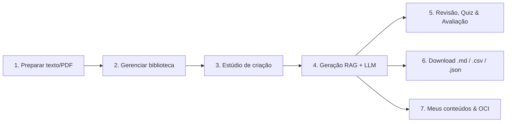

# Tutorial Técnico Passo a Passo — Uso do MVP MentorIA Tech

**Baseado no guia interativo produzido por:** Andrea De Nardi Gonzalez ([Tutorial Trupeer](https://app.trupeer.ai/view/uApUfd7nr/criacao-de-conteudo-educacional-com-ia))  
**Revisão e padronização técnica:** Lídia Moura — Líder Técnica  
**Aplicação Online:** [mentoria-tech.streamlit.app](https://mentoria-tech.streamlit.app/) *(Tema Claro — padrão Demo Day)*

---

## 1. Visão Geral

Este guia descreve, passo a passo, como cadastrar textos técnicos, transcrições de aulas e documentos (`.pdf`, `.md`, `.txt`) na biblioteca do **MentorIA Tech**, configurar o **Estúdio de criação**, gerar múltiplos formatos pedagógicos com **RAG + IA** (`Resumo Estruturado`, `Guia Passo a Passo (Tutorial)`, `Flashcards de Memorização`, `Quiz Interativo`, `Resumo Executivo (TL;DR)` e `Roteiro de Aula / Vídeo`), exportar os arquivos e acompanhar a persistência em nuvem na **Oracle Cloud (OCI)** através da seção **Meus conteúdos**.

---

## 2. Pré-requisitos e Formatos Suportados

- **Entradas aceitas:** arquivos `.pdf`, `.md` ou `.txt` (até `20 MiB`), ou texto técnico/transcrição colado diretamente na interface (convertido internamente para `.txt`).
- **Perfis disponíveis:** `Iniciante / Transição` (`Iniciante`), `Desenvolvedor Jr/Pleno` (`Jr/Pleno`), `Líder Técnico / Arquiteto` (`Tech Lead`) e `Gestor / Executivo` (`Gestor`).
- **Níveis de profundidade:** `Básico (Didático)`, `Intermediário` e `Avançado`.
- **Saídas para download:** **Markdown (`.md`)**, **CSV pronto para Anki (`.csv`)** e **JSON estruturado (`.json`)**.

---

## 3. Passo a Passo na Plataforma

### Passo 1 — Preparar o texto ou transcrição da aula
1. Selecione o texto técnico ou a transcrição da aula na fonte original (ex.: editor de texto, documentação ou anotações de aula) e copie todo o conteúdo.
2. Acesse a aplicação **MentorIA Tech** no navegador (localmente em `http://localhost:8501` ou na URL publicada).

### Passo 2 — Cadastrar texto técnico na biblioteca (`+ Salvar Texto como .txt`)
1. No menu de navegação, acesse **Gerenciar biblioteca** (ou abra a seção de gerenciamento na tela de biblioteca).
2. No formulário de texto, preencha o **título do documento**.
3. Cole o texto técnico ou transcrição copiada no campo de conteúdo.
4. Clique em **`+ Salvar Texto como .txt`** para registrar o material no acervo da sessão.

### Passo 3 — Carregar um documento de exemplo ou PDF local
Você pode adicionar arquivos ao acervo de duas formas:
- **Exemplo integrado:** clique em **`📘 Carregar exemplo real (Machine_Learning.pdf)`** para testar imediatamente com o documento técnico padrão do projeto.
- **Upload local:** clique na área de upload, selecione um arquivo `.pdf`, `.md` ou `.txt` do seu computador e clique em **`📥 Adicionar à Biblioteca`**.

### Passo 4 — Gerar um Resumo Estruturado no Estúdio de criação
1. Acesse **Estúdio de criação** no menu lateral.
2. Selecione o **material de origem** cadastrado na biblioteca (ex.: o `.txt` salvo ou o PDF carregado).
3. Escolha o **perfil do destinatário** e o **nível de profundidade** desejados.
4. Em **Formato de Saída**, selecione **Resumo Estruturado** (e ajuste a quantidade de itens, se aplicável).
5. Clique em **`✦ Gerar Conteúdo Educacional com IA`** e aguarde a resposta do pipeline RAG + LLM.

### Passo 5 — Baixar o conteúdo gerado (`.md`, `.csv` para Anki e `.json`)
1. Após a geração concluir, role até a área de resultados.
2. Confira as citações de páginas e `chunk_ids` exibidas em cada bloco (garantindo rastreabilidade anti-alucinação).
3. Utilize os botões de exportação disponíveis:
   - **`📝 Baixar Markdown`** — salva o material formatado em `.md` para leitura ou edição.
   - **`🗂️ Baixar CSV (Anki)`** — exporta cartões prontos para importação direta no Anki.
   - **`⬇️ Baixar JSON`** — salva o payload estruturado (inclusive reutilizável em outras LLMs ou no NotebookLM).

### Passo 6 — Alternar perfil e gerar um Guia Passo a Passo (Tutorial)
1. Sem precisar reenviar o documento, ajuste os parâmetros no **Estúdio de criação**:
   - Altere o perfil para **Desenvolvedor Jr/Pleno**.
   - Selecione **Guia Passo a Passo (Tutorial)** em **Formato de Saída**.
2. Clique novamente em **`✦ Gerar Conteúdo Educacional com IA`** para adaptar a mesma fonte técnica a um nível prático de implementação.

### Passo 7 — Gerar Flashcards de Memorização para Iniciante / Transição
1. Selecione na lista de materiais o documento desejado (por exemplo, as anotações ou transcrição da aula salva em `.txt`).
2. Altere o perfil para **Iniciante / Transição** e escolha **Flashcards de Memorização**.
3. Clique em **`✦ Gerar Conteúdo Educacional com IA`**.

> **Dica para Quiz Interativo:** ao selecionar **Quiz Interativo**, o gabarito permanece oculto por padrão até o usuário acertar a questão ou atingir o limite de **3 tentativas**, exibindo então a explicação fundamentada e as fontes do documento.

### Passo 8 — Revisar, avaliar, recuperar sessão e consultar “Meus conteúdos” (OCI + JSON)
1. Expanda os itens gerados (ex.: os flashcards) para revisar perguntas, respostas e referências de páginas/trechos.
2. Na seção **Avaliação do Conteúdo**, selecione a nota em estrelas (1 a 5) e clique em **Enviar Avaliação** para registrar o feedback da sessão.
3. **Recuperar sua evolução sem login (LGPD / Zero PII):** no menu lateral, abra **🪪 Identidade anônima** e copie o seu **`usuario_id`** (UUID anônimo). Caso mude de navegador ou dispositivo, basta colar esse UUID em **Recuperar histórico → Aplicar ID** (ou abrir a URL com `?uid=<seu_usuario_id>`) para continuar com acesso aos seus Quizzes e evolução salvos no servidor (`sessao_id` identifica apenas a visita atual).
4. Acesse **Meus conteúdos** no menu lateral para:
   - Visualizar as prévias de todos os materiais gerados na sessão;
   - Inspecionar o **payload JSON** completo de cada geração;
   - Conferir os metadados de persistência no bucket privado da **Oracle Cloud (`mentoria-tech-artifacts`)**.
4. Ao concluir a revisão, retorne à **Visão geral** para iniciar novos ciclos de estudo ou gerenciar sua biblioteca.
